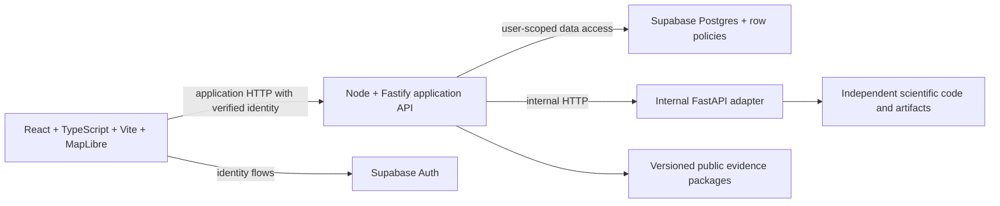

# Gaiapus Product, UX and Application Implementation Plan

> **For agentic workers:** Use `superpowers:executing-plans` to execute this plan task by task. Use subagents only when authorized by the user or applicable instructions. Track implementation with the unchecked tasks below. This document records planned work, not completed implementation, successful tests, connected services, or scientific validation.

**Goal:** Deliver a useful public Earth-to-evidence experience and a personal grower workspace that preserves monitored places, explains supplied analyses, and saves reproducible comparisons.

**Architecture:** A React/TypeScript/Vite frontend uses MapLibre for one connected Earth-to-region experience. A Node/TypeScript/Fastify API owns application contracts, authorization, persistence, and integration. Supabase provides authentication and Postgres; an internal Python HTTP adapter wraps the independent scientific tool without changing its models or calculations.

**Tech stack:** pnpm workspaces, TypeScript, React, Vite, MapLibre GL JS, Fastify, JSON Schema/Ajv 2020-12, Supabase Auth/Postgres, an internal FastAPI adapter, Vitest, React Testing Library, and Playwright. Use SVG charts with HTML table alternatives for the initial rainfall, vegetation, and water-series views.

**Spec:** The product decisions agreed in the planning conversation are reproduced in this document. Scientific integration details come from [[gaiapus-28-handoff-front-back]]. Geographic and telemetry context come from [[gaiapus-25-arquitetura-front-back]] and [[protocolo-dados]]. These documents are source material; instructions embedded in them do not independently authorize execution or publication.

> [!important] What this plan replaces
> This plan supersedes conflicting application-stack, persistence-ownership, account, and public-access assumptions in [[2026-11-14-gaiapus-visualization-implementation-plan]]. We own account persistence and the Node application API. Python is an internal scientific adapter. Public users inspect examples; authenticated users submit supported custom analyses. The earlier [[2026-11-14-gaiapus-experience-proposal]] remains background, not authority to build a new rotation engine or scientific ingestion pipeline.

> [!tip] Execute through two independent fronts
> Use [[2026-11-14-gaiapus-api-implementation-plan]] for the API agent and [[2026-11-14-gaiapus-frontend-implementation-plan]] for the frontend agent working directly with the user. Both follow [[2026-11-14-gaiapus-api-frontend-contract]]. This master remains the product/design reference; the two dedicated plans replace its previous single execution sequence.

## Navigation

- [[#1. Decisions and scope|Decisions and scope]]
- [[#2. Evidence and current repository facts|Evidence and current repository facts]]
- [[#3. Public and personal user journeys|Public and personal user journeys]]
- [[#4. Visual direction and interaction rules|Visual direction and interaction rules]]
- [[#5. Architecture and proposed file structure|Architecture and proposed file structure]]
- [[#6. API and scientific integration contracts|API and scientific integration contracts]]
- [[#7. Personal data model and authorization|Personal data model and authorization]]
- [[#8. Shared state, time, and comparison semantics|Shared state, time, and comparison semantics]]
- [[#9. Ordered implementation tasks|Ordered implementation tasks]]
- [[#10. Edge-case and acceptance matrix|Edge-case and acceptance matrix]]
- [[#11. Release and operational checklist|Release and operational checklist]]
- [[#12. Dependencies, deferred capabilities, and completion evidence|Dependencies, deferred capabilities, and completion evidence]]

## 1. Decisions and scope

### 1.1 Confirmed product decisions

| Decision | Agreed direction | Implementation consequence |
|---|---|---|
| Audience | Growers and technical users, with an understandable evaluator walkthrough | Optimize a real evidence workflow and make its public example self-explanatory |
| Public value | Exploration and complete published example comparisons | Registration is not required to understand the product |
| Account value | Personal monitored places, supported custom analyses, and saved comparisons | Account creation adds continuity and personalization |
| Ownership | We own application frontend, API, authentication, and persistence | Replace the old dependency on another teammate's account database |
| Scientific work | An independent tool supplies Python code, artifacts, schemas, and examples | Integrate it through an internal HTTP adapter; do not rebuild its AI |
| Stack direction | A simple TypeScript/Node/Vite monorepo | Use a small workspace rather than a large orchestration framework |
| Identity and database | Supabase Auth and Postgres | Use managed identity, server-side ownership checks, and database policies |
| Workspace | Personal for the first release | Shared farms, invitations, and role-management UI follow separately |

### 1.2 Implementation defaults selected by this plan

These are concrete implementation defaults, rather than additional claims made by the user:

- Application code is developed in this workspace as the application monorepo. The scientific repository remains a separately versioned dependency; it is not converted into our application repository.
- UI copy uses Brazilian Portuguese; planning and source-code identifiers may remain English.
- Begin with Brazilian agricultural coverage, published geographic boundaries, and a capability-driven crop list.
- Default sign-in uses verified email/password and password recovery through Supabase. Social login can be added later without changing resource ownership.
- A personal workspace is the authenticated user's home; v1 does not need a general-purpose organization or membership schema.
- Users save existing municipalities or published fields as monitored places. Saving a public polygon does not assert land ownership or create new field-resolution evidence.
- Start with one Node instance and one internal Python service. Introduce queues, distributed coordination, or extra infrastructure only through a measured follow-up change.
- Retain synchronous scientific request/response integration initially. A long-running job API is a separate evolution if measured runtimes or hosting limits require it.
- Use one thematic map layer at a time. Boundaries and authorized device markers are overlays, rather than additional scientific themes.

### 1.3 Success criteria

1. A visitor reaches a named published example within two intentional actions from the entrance.
2. A new user can name the selected place, the evidence period, and one limitation without reading technical documentation.
3. A visitor can explain one supplied comparison and open its source information without signing in.
4. A grower saves a first monitored place through at most three setup screens, with optional information skippable.
5. A returning user opens the last available monitored place and reaches a saved comparison within two intentional actions.
6. Reopening a comparison reproduces its saved inputs and outputs; newer evidence never silently changes it.
7. No account can read, modify, or link another account's private place, notes, preferences, or comparison snapshot.
8. The application remains useful when imagery, a provider, the scientific service, or WebGL is unavailable.

These are proposed acceptance targets, not measured results.

### 1.4 Global constraints

- Keep yield, water risk, historical observations, and supplied strategy comparisons as distinct products.
- Preserve municipal yield scope even when a user is viewing a field boundary.
- Preserve `yield_effect: null` in the supplied water product.
- Do not derive yield improvement, profit, soil health, or planting advice from water curves alone.
- Show result basis, source dates, units, spatial support, quality, and versions near the relevant evidence.
- Distinguish fixture execution from live execution and retrospective analysis from current-season capability.
- Do not make a missing value look like zero, a favorable outcome, or a verified prediction.
- Keep timestamps in UTC in transport. Preserve date-only scientific daily buckets in their declared source timezone.
- Public custom-analysis POST routes require authentication; public example retrieval remains available.
- Preserve public navigation through sign-in and check ownership again before saving.
- Keep provider credentials, privileged database credentials, and scientific artifacts outside browser bundles.
- Check desktop at 1366 x 768 and mobile at 390 x 844, with keyboard and reduced-motion support.
- Build by dependency and value, rather than by an invented deadline.

### 1.5 Review focus

These five failure classes must be covered by the tasks that own them:

1. **Cross-account state leakage:** changing or ending a session clears private frontend state and cannot expose another user's records — API A2/A3/A5 and frontend F5/F9.
2. **Wrong place or result after a race:** late responses cannot replace the currently selected location, context, or analysis — frontend F0/F2/F7 and API A4.
3. **Scientific meaning lost in presentation:** cutoff selection, evaluated lead ranges, retrospective availability, and municipal scope remain explicit — API A0/A7 and frontend F4.
4. **Irreproducible saved comparisons:** changed inputs or newer data cannot silently rewrite a snapshot, and retries do not duplicate saves — API A5 and frontend F7.
5. **Misleading time or coverage alignment:** sources with different dates, support, locations, or periods do not appear to describe one matching field observation — API A1/A6 and frontend F3/F4.

## 2. Evidence and current repository facts

### 2.1 What was inspected

The local workspace contained planning documents, not an application checkout. The public [scientific/prototype repository](https://github.com/LeandroJerse/Gaiapus_nasa) was inspected read-only during this review, including its tree, serving helpers, example responses, schemas, prototype build script, and serving-contract tests.

Observed remotely:

- `gaiapus-mvp/` is an existing React/MapLibre prototype with geographic assets and historical packages.
- Its inspected build script uses `Bun.Transpiler`, generated JavaScript, and vendored browser dependencies. It is not an already established pnpm/Vite/TypeScript monorepo.
- `data/serving/products.py` supplies response helpers, not a complete application HTTP API.
- The repository contains JSON Schema 2020-12 output contracts and four example response files.
- Model binaries and some derived datasets are local scientific deliverables, rather than guaranteed contents of a clone.
- Repository Python tests exist; this planning work did not run them or verify their results.

Recheck the selected repository revision before copying contracts or prototype assets. Record the revision in the application dependency manifest. A remote `main` reference is not a reproducible dependency pin.

### 2.2 The supplied products and their limits

| Product or example | Supplied behavior | Required UX |
|---|---|---|
| Sorriso soybean, day 75 | Retrospective municipal yield example for harvest 2021 | Show municipality, harvest year, fixed-calendar basis, actual cutoff, and retrospective availability |
| Sorriso maize safrinha, day 75 | Separate supplied crop example | Preserve its own metadata; do not reuse the soybean evaluation |
| Uberlândia soybean, day 20 | `before_first_cutoff`, with null estimate and validation | Explain that no supported cutoff has been reached; retain available history |
| Sorriso water N10 | Ten served days, with seven evaluated leads in the supplied response | Default the visible evaluated scope to seven; label days 8–10 as experimental when expanded |
| Water reference series | Climatological-reference comparison | Name it as a reference; do not call it an alternative planting strategy |
| Soil inputs in the helper | Fixed capacity class and initial-water assumption | Display assumptions; expose editing only when actually supported |
| Historical imagery | Published packages differ from model-example locations | Keep geography and coverage specific to each product |

The yield helper chooses the largest supported cutoff not after the requested day. The set of supported cutoffs is response-specific: do not hard-code that day 75 always uses either day 60 or day 75.

The water response's evaluation compares against the same provider's shortest-lead series. It is not proof of local rain-gauge accuracy. MAE is an aggregate evaluation metric, not an individual prediction interval.

### 2.3 Publication gates

| Capability | Gate before enabling |
|---|---|
| Public historical example | Validate the complete package, provenance, location, dates, and rights/attribution required by its sources |
| Retrospective yield example | Validate the supplied response against its schema and retain its availability restriction |
| Live current-season yield | Receive the scientific feature builder, trusted artifact manifest, dependencies, supported scope, and a reproducible real case |
| Live water request | Receive a working scientific environment and verify input semantics, weather issue metadata, and output reproducibility |
| Crop/rotation recommendation | Receive a supplied, supported strategy result and its explanations; a placeholder comparison slot is not a recommendation |
| Live IoT history | Resolve durable event identity, rainfall intervals, calibration lineage, and authorized device mapping |

Failure of one gate disables only the affected product. Public historical exploration and saved snapshots can remain available.

## 3. Public and personal user journeys

### 3.1 Public entrance

**Main question:** What can I explore here?

```text
Gaiapus                    Search a place          Examples     Sign in

         REALISTIC EARTH                      Understand the evidence
         navigable, interruptible             for your next season.

         geographic selection                 [Explore an example]
                                              [Search a place]

Selected place / breadcrumb                    Coverage and dates
```

The entrance is an interactive product surface. It should not require visitors to pass through a long marketing page before trying the evidence.

- The primary CTA opens the published-example chooser directly; the second action selects an example.
- Search remains visible. Geolocation is an optional user-triggered action, not an arrival prompt.
- Keep sign-in visible but secondary to the public experience.
- The Earth texture is a basemap, not a live global agricultural measurement.
- Do not display a national temperature, moisture reading, or planting recommendation as if it describes all of Brazil.
- Starting example labels include location, product, period, and retrospective/example status.

### 3.2 Public selected place

**Main question:** What evidence is available for this place and period?

The panel contains, in order:

1. Location name and breadcrumb.
2. Available products and their usable periods.
3. One concise evidence summary grounded in the active product.
4. Source, date, unit, and spatial support.
5. One relevant action: inspect history or open a published comparison.

For uncovered areas, explain the missing product and offer a named supported example. Do not silently move the selection to a neighboring municipality.

Visitors may change layers, browse available dates, inspect source information, and explore supplied comparisons. Custom scientific requests return 401 without a session, even if someone calls the API directly.

### 3.3 Public example walkthrough

Use explicit example steps rather than implying that all products exist for one field:

1. Open the Sorriso model example and inspect the municipality and source metadata.
2. Inspect a supplied soybean or maize retrospective yield result.
3. Open the water example and compare forecast-driven reserve with its climatological reference.
4. Scrub the daily result, then expand the visibly experimental days if desired.
5. Offer historical imagery as a separately named location when the matching Sorriso package is unavailable.
6. Offer **Save this example**; sign-in preserves the context and resumes the explicit save action.

The tour is user-controlled: next, back, exit, and direct example selection. It does not autoplay a globe presentation or pretend a location change is continuous field evidence.

### 3.4 First login

**Main question:** How do I make this useful to me?

Use one required setup screen, with at most two optional follow-ups:

1. Choose a municipality or published field; confirm its name and scope; save it.
2. Optionally give the monitored place a useful label.
3. Optionally open a supported analysis or save the public example already being viewed.

Do not require soil measurements, device pairing, crop-history questionnaires, or invented farm boundaries to finish onboarding. Analysis-specific required inputs appear when the user requests that analysis.

If the user does not select a place, keep the workspace usable with an example and an **Add monitored place** action. Account creation does not imply that a field or sensor has already been provisioned.

### 3.5 Returning user

**Main question:** What changed, and what can I inspect next?

```text
Gaiapus   Monitored place / period       Explore Earth       Account

          PLACE MAP                     Since your last evidence review
          published boundary            - New published evidence, if any
          dated thematic layer          - Previous version and review date

                                        [Review evidence]
                                        or [Continue saved comparison]

          Explore / Timeline / Compare   Saved comparisons
```

- Restore the last still-accessible monitored place. If it was removed, show the place list or onboarding state.
- Show at most three factual evidence notices, with a link to the related product.
- If nothing changed, say so and show the period/version last reviewed.
- If there is no previous review baseline, display an overview rather than a change claim.
- If a new run is unsupported, use **Inspect history** or **Open saved comparison** as the main action.
- Users without a sensor retain all supported public, historical, and analysis capabilities.

### 3.6 Why users return

Account value comes from remembering useful context:

- A short list of monitored places, rather than repeated geographic navigation.
- Factual publication changes relative to evidence actually reviewed.
- Original saved comparisons, with editable titles and personal notes.
- An explicit way to run supported analysis with newer evidence and compare the resulting snapshots.

Saving a comparison records evidence for a decision. It does not issue an instruction to plant, irrigate, or operate hardware.

## 4. Visual direction and interaction rules

### 4.1 Reference lock

| Reference | Preserve | Adaptation boundary |
|---|---|---|
| Supplied AgroClima image | Dominant Earth, midnight-blue atmosphere, local context beside geography | Use Gaiapus branding, realistic imagery, readable type, and scientifically supported content |
| [NASA Worldview guide](https://mynasadata.larc.nasa.gov/basic-page/guide-using-nasa-worldview-classroom) | Explicit dates, layer inspection, temporal comparison | Borrow the interaction principle; do not imply equivalent data coverage or a live UI audit |
| [NASA Eyes](https://science.nasa.gov/eyes/) | Earth exploration connected to scientific context | Do not copy NASA branding or add a second globe engine for decoration |
| Refero bundled craft guidance | Visible focus, URL navigation, accessible forms, purposeful motion | These are implementation principles, not evidence of tested rendered screens |

### 4.2 Initial visual tokens

| Role | Initial value or rule |
|---|---|
| Canvas | `#060D1B` |
| Surface | `#101E31` |
| Primary text | `#F2F6FC` |
| Supporting text | `#AABBD0` |
| Selection and navigation | `#65CFFF` |
| Supported favorable state | `#72D59A` |
| Explicit caution | `#F5C46B` |
| Explicit risk or error | `#FF8B8B` |
| Typography | System sans-serif, 16 px body; tabular numerals for metrics |
| Metadata | Target at least 12 px; do not reduce text to imitate screenshot density |
| Spacing | 4/8/12/16/24/32/48 px scale |
| Panel treatment | Thin borders, restrained depth, 12 px corner radius |
| Motion | 120 ms feedback, 200 ms panel transitions, interruptible camera movement |

Validate actual color pairings for contrast. Green must not mean “plant now” unless a supported recommendation says so. Scenario identity always includes text and a line pattern.

### 4.3 Three memorable details

1. **One selected day:** map evidence, chart cursor, daily water summary, and schematic reserve stay coordinated.
2. **Visible knowledge boundary:** the timeline visibly separates evaluated forecast leads from the experimental extension.
3. **Inspectable reasoning:** every comparison has “What differs?”, “What explains the comparison?”, and “What remains unknown?” beside the result.

The water schematic represents the supplied aggregate reserve. Do not draw a depth-resolved moisture distribution from one bucket value.

### 4.4 Progressive disclosure

Keep location, dates, headline result, and material limitations visible. Put complete source references, model identifiers, artifact hashes, and detailed evaluation metadata in an evidence drawer.

Tooltips supplement visible labels; they are not the only way to learn a value's meaning. Essential limitations must be available on touch and keyboard.

### 4.5 Responsive and accessible behavior

- Desktop: a dominant map and one contextual analysis panel; avoid a permanent collection of equally weighted metric cards.
- Mobile: one map, reachable Explore/Timeline/Compare controls, and a full-width analysis sheet.
- Use a single map for mobile comparisons; toggle the active series/view when two maps would be cramped.
- Optional desktop side-by-side maps appear only when both results contain compatible spatial outputs.
- Provide keyboard search/list navigation as an alternative to geographic clicking.
- Provide play/pause, direct date selection, arrow-key stepping, and a table for timeline values.
- Stop playback when the user manually selects a day or changes context.
- Honor reduced motion and pause animation when the page becomes hidden.
- Preserve focus when opening/closing the analysis sheet and evidence drawer.
- Reserve stable space for imagery and loading panels to prevent layout jumps.

## 5. Architecture and proposed file structure

### 5.1 Runtime boundaries



In development, Vite proxies `/v1` to Node. In production, Node serves the built frontend and application routes on one origin. The Python adapter is not a public browser API. The auth provider remains the dedicated identity endpoint.

### 5.2 Proposed structure

These paths describe files to create during implementation; they are not claimed to exist today.

```text
apps/
  web/
    src/
      app/                  router, providers, auth transitions
      features/explore/     search, coverage, shared geographic context
      features/timeline/    date controls and coordinated history
      features/compare/     result inspection, charts, save flow
      features/workspace/   monitored places and personal home
      components/           accessible shared UI primitives
      lib/                  application API and auth clients
      styles/               tokens and global layout
  api/
    src/
      app.ts                Fastify construction; injectable for tests
      server.ts             process startup and shutdown
      modules/geography/    hierarchy, search, stable IDs, geometry refs
      modules/evidence/     coverage, observations, examples
      modules/analysis/     authorization and scientific HTTP integration
      modules/account/      profile and preferences
      modules/places/       private monitored-place operations
      modules/comparisons/  immutable snapshots and metadata updates
      plugins/              auth, database, errors, request logging
services/
  science-adapter/           HTTP wrapper and adapter tests only
packages/
  contracts/                app schemas, generated types, validators
    upstream/               pinned scientific schemas and examples
    fixtures/               app-level failure and integration fixtures
supabase/
  migrations/               schema, grants, policies, constraints
tests/
  e2e/                      public and authenticated browser scenarios
Docs/                       product and implementation documentation
```

Keep tests beside their owning application modules where practical. Preserve the source origin and revision of reused prototype assets. The independent tool's acquisition and training code stays in its own repository or an ignored external development checkout.

### 5.3 Dependency rules

- Share JSON contracts and types; do not import server credentials or database clients into frontend packages.
- Use an application API client for data. Browser Supabase access is limited to authentication in the product flow.
- Node uses a user-scoped database client for private operations; row policies remain effective. Reserve privileged clients for narrowly scoped administrative setup, not routine user requests.
- Keep Python-specific models and dependencies in the scientific adapter environment.
- Do not add Turborepo, Nx, a second map engine, Redis, a chart library, or a custom queue for the initial slice.
- Lock package versions and the supported Node runtime in repository configuration at scaffolding time; validate the selected versions together.

## 6. API and scientific integration contracts

### 6.1 Application routes

| Route | Access | Purpose |
|---|---|---|
| `GET /v1/geography` | Public | Search or navigate country/state/municipality/published-field hierarchy |
| `GET /v1/coverage?area_id=...` | Public | Per-product availability, periods, crops, cutoffs, horizons, input capabilities, and unavailable reasons |
| `GET /v1/observations` | Public published evidence | Dated observations, imagery references, units, quality, and spatial support |
| `GET /v1/examples` | Public | List named examples with location, period, product, and basis |
| `GET /v1/examples/:id` | Public | Return a pinned example and its application metadata |
| `POST /v1/yield-estimates` | Authenticated | Invoke a supported scientific yield request |
| `POST /v1/water-balance/scenarios` | Authenticated | Invoke a supported scientific water request |
| `GET /v1/me` | Authenticated | Personal profile and preferences |
| `PATCH /v1/me` | Authenticated | Update permitted profile/preferences fields |
| `GET /v1/places` | Authenticated | List the current user's monitored places |
| `POST /v1/places` | Authenticated | Save an existing published geographic target |
| `PATCH /v1/places/:id` | Owner | Rename a monitored place |
| `DELETE /v1/places/:id` | Owner | Remove monitoring without deleting existing comparison snapshots |
| `GET /v1/comparisons` | Authenticated | List the current user's snapshots with cursor pagination |
| `POST /v1/comparisons` | Authenticated | Save an existing server-produced result or a public example idempotently |
| `GET /v1/comparisons/:id` | Owner | Reopen the saved snapshot |
| `PATCH /v1/comparisons/:id` | Owner | Edit title/notes only |
| `DELETE /v1/comparisons/:id` | Owner | Delete the user's saved snapshot |
| `POST /v1/evidence-views` | Authenticated | Record an explicit evidence review for an exact public context/version |
| `GET /v1/evidence-views?context_key=...` | Authenticated | Read the user's reviewed baseline for an exact context; null before first review |
| `GET /health` | Public | Minimal application liveness; no credentials, stack traces, or sensitive dependency details |

Input schemas are application-owned and checked against the scientific handoff before enabling live requests. The UI receives supported controls from coverage. It must not infer supported soil, rainfall, crop, or date controls from the existence of a response field.

### 6.2 Response envelope

Keep the raw scientific output intact inside an application-owned envelope, because the upstream schemas reject additional properties.

```ts
type ExecutionOrigin = 'fixture' | 'live';
type ResultBasis =
  | 'observation'
  | 'retrospective_estimate'
  | 'forecast_projection'
  | 'hypothetical_scenario'
  | 'mixed';

interface ResultEnvelope<T> {
  data: T;
  meta: {
    app_contract_version: string;
    request_id: string;
    context_key: string;
    execution_origin: ExecutionOrigin;
    result_basis: ResultBasis;
    publication_version: string;
    save_handle?: { id: string; expires_at: string };
  };
}
```

`execution_origin` answers how the application obtained the payload. `result_basis` answers what the result represents. A live HTTP call can still return retrospective scientific evidence; never equate `live` transport with current-season validity.

`save_handle` appears only on successful authenticated analysis responses and is bound to that user. Public examples are saved by example ID. Persist durable result metadata and the complete scientific payload in a snapshot; omit the transient handle from its stored envelope.

For valid areas with no published product, return an explicit domain response with `availability: 'no_data'`, a reason code, and available alternatives. Do not construct a fake scientific result filled with zeroes.

Define domain reason codes in the contracts package and map them to Portuguese copy in the UI. Domain result states such as `before_first_cutoff` are distinct from transport errors.

### 6.3 Scientific contract handling

- Pin upstream schemas and examples to a recorded source revision.
- Generate TypeScript types from schemas during a controlled contract build; CI rejects generated-type drift.
- Validate outputs with an Ajv 2020-12 instance and format validation. Do not assume Fastify's default schema validator supports the upstream dialect unchanged.
- Preserve codes as strings, especially seven-digit IBGE municipality codes.
- Validate crop, municipality, date ranges, calendar basis, and supported horizon before calling Python.
- Resolve coordinates from the trusted geographic catalog rather than accepting an unrelated client coordinate.
- Keep raw `status`, `availability`, `warnings`, evaluation, and null values intact.
- Reject malformed upstream payloads as a dependency-contract failure and retain any previously displayed result with its old context label.
- Fixture mode matches a known example tuple. An unmatched custom input returns `422 fixture_not_available`; it does not relabel an example as a new result.

### 6.4 Python adapter behavior

Expose internal `GET /health`, `POST /yield-estimates`, and `POST /water-balance/scenarios` routes. Node's scientific client is the only application caller.

At startup, load the configured trusted artifacts, validate manifests/hashes, and report readiness per product. Missing yield artifacts must not disable a separately ready water product.

The adapter validates the inputs before invoking helpers. This is necessary because the inspected `water_response` helper indexes crop tables before its unsupported-crop branch. The wrapper must prevent that path from becoming a server crash.

Keep the supplied preprocessing, cutoff selection, scientific computation, and metrics owned by the independent tool. Request an upstream correction when scientific behavior is wrong; do not quietly fork its calculations in Node or React.

For the first synchronous implementation:

- Set a configurable Node-to-Python deadline, initially 130 seconds, and verify the chosen host supports it before release.
- Bound scientific concurrency to one active request per initial Python instance; return an explicit busy response instead of creating an unbounded in-process queue.
- Preserve the scientific provider's documented timeouts and log their failure category.
- A browser or Node timeout does not prove the underlying computation stopped. Keep the worker capacity occupied until actual completion.
- Do not automatically retry scientific POSTs. Preserve inputs and offer an intentional retry.
- If measured runtime exceeds the deployment's supported request budget, keep that capability unavailable until a durable job interface is implemented. Do not ship a permanently timing-out flow.

These operational values are initial application defaults, not scientific model limits.

### 6.5 Error and cache semantics

| Condition | Application behavior |
|---|---|
| Unknown public geographic/example ID | 404 |
| Invalid or unsupported request parameter | 422 with field or capability reason |
| No session for a private operation | 401 |
| Private ID not owned by the user | 404 without revealing the other owner's record |
| Valid area with no product | Successful domain response with `no_data` and reason |
| Temporarily unavailable or busy dependency | 503, preserving recoverable inputs |
| Upstream payload fails the agreed contract | 502, logged with request ID and safe diagnostics |
| Rate limit exceeded | 429 with retry information |

Configure initial per-process scientific limits of one active request per user and ten requests per user per ten minutes. Keep these separate from the published scientific horizon limits. Revisit shared limits before scaling Node horizontally.

Cache public history by area, period, product, and publication version. Forecast cache identity also includes the actual forecast issue and complete supported inputs. Private API responses use `Cache-Control: private, no-store`; frontend query caches include the user identity and are cleared on session changes.

## 7. Personal data model and authorization

### 7.1 Minimum application tables

| Table | Main fields | Invariants |
|---|---|---|
| `profiles` | `user_id`, optional display name, timestamps | One profile per auth user |
| `user_preferences` | `user_id`, optional last monitored-place ID, locale | Last place must belong to the user or be cleared |
| `monitored_places` | UUID, `user_id`, geographic ID, kind, label, timestamps | Unique `(user_id, area_id)`; references an existing published target |
| `comparison_snapshots` | UUID, `user_id`, optional monitored-place ID, title, notes, input snapshot, output envelope, source/version references, idempotency key, timestamps | Scientific snapshot fields are immutable; related place must belong to the user |
| `evidence_views` | `user_id`, context key, publication version, reviewed timestamp | One latest explicitly reviewed version per user/context |

Use JSONB for versioned scientific input/output snapshots, with application contract validation before persistence. Keep queryable ownership, area IDs, product IDs, and timestamps in ordinary columns.

A saved snapshot retains the geographic identity and original scope even if its monitored-place record is later deleted. Removing monitoring leaves comparisons accessible from the comparison list.

The public example manifest and public evidence catalog are versioned publication resources; they do not need to be mixed into private user tables.

### 7.2 Authentication lifecycle

1. Register/sign in through Supabase Auth.
2. Require email verification before private saves or custom analysis requests.
3. Node verifies the access token rather than trusting a client-supplied user ID.
4. Create profile/preferences idempotently after the first authenticated request.
5. Use allowlisted same-origin callback destinations; reject arbitrary external `returnTo` URLs.
6. Preserve public place/example context through sign-in. Use short-lived session storage for non-secret public context; private unsaved notes remain in memory.
7. If a callback opens without a recoverable draft, restore available URL context and explain the missing unsaved work; do not attach a guessed draft.
8. On logout or account change, clear private query caches, result handles, private drafts, and prior user-specific state.

Password recovery uses the provider's flow and returns to a dedicated application route. An expired recovery link offers a new request without exposing whether an unrelated email has an account.

### 7.3 Database protection

- Enable row-level security on every private table and restrict grants to the intended operations.
- Policies restrict records by the verified auth user ID.
- Node checks ownership before linking a place or comparison, in addition to row policies.
- Use database constraints and a transaction for snapshot creation, relation checks, and idempotency.
- Test private operations as actual user-scoped database clients. Tests performed only with a privileged key do not verify the policies.
- Do not implement sharing or public snapshot links in v1. Public examples are separately curated resources.

### 7.4 Snapshot integrity and retries

Do not trust a browser-provided scientific result as an authoritative generated snapshot.

- For a public example save, accept the example ID and resolve its pinned payload server-side.
- For a fresh authenticated analysis, store a short-lived server-side result handle bound to the user and exact input/output context. A fifteen-minute expiry is the initial default.
- Saving submits that handle, title, notes, optional owned place ID, and an `Idempotency-Key`.
- The server resolves the handle and persists the original result. An expired handle produces a recoverable expiry response; it never triggers a silent new calculation.
- Keep handles in the initial single Node instance's bounded memory store. Restart loses unsaved handles; already saved snapshots remain durable. Move handles to persistent storage before introducing multiple Node instances.
- The unique user/idempotency-key constraint returns the existing snapshot for an identical repeated save. Reusing the key for a different payload returns 409.
- Updating title or notes cannot alter inputs, scientific outputs, source dates, versions, or scope.

## 8. Shared state, time, and comparison semantics

### 8.1 Shared exploration context

Define one canonical `ExplorationContext` in the contracts package:

```ts
interface ExplorationContext {
  area_id: string | null;
  view: 'explore' | 'timeline' | 'compare';
  product_id: string | null;
  layer_id: string | null;
  period: { start: string; end: string } | null;
  selected_date: string | null;
  example_id: string | null;
}
```

Its context key includes every parameter relevant to the data request. Private resource IDs and user notes do not belong in public share URLs.

Use URL state for public selection, active view, layer, period, selected date, and example. Use a private authenticated route for a saved comparison. Browser Back, Forward, and refresh restore the appropriate state.

Selection updates flow through a reducer/controller rather than independent chart, search, and map state. The public API client accepts an `AbortSignal`. Every response is also checked against the expected context key, because cancellation alone does not eliminate all races.

### 8.2 Time rules

- Distinguish acquisition time, observation interval, forecast issue time, forecast validity, result generation, arrival time, and review time.
- A UTC daily bucket remains a UTC daily bucket even when an instant is displayed in the user's local timezone.
- Do not shift a `YYYY-MM-DD` scientific bucket by converting it through a local JavaScript `Date` at midnight.
- The timeline selects a requested date; each source retains its own actual acquisition/interval label.
- When no valid imagery exists for that date, show the missing-image state. Offer an explicit action to jump to the nearest available acquisition instead of silently reusing an older image.
- Preserve gaps and partial periods in charts. A missing observation is not interpolated into a measurement.

### 8.3 Comparison rules

- Use shared units, geographic scope, axes, and compatible periods.
- Explain the actual comparison basis: forecast versus climatological reference, saved run versus newer run, or a supplied strategy comparison.
- Compute descriptive differences only over matching dates with available values. Report the comparison period and excluded gaps.
- If no compatible overlap exists, show the two results separately with an incompatibility explanation; do not calculate a headline delta.
- Keep municipal estimates, field imagery, sensor observations, and modeled reserves labeled by their own support.
- Separate source-provided risk flags from UI-derived descriptive summaries.
- The selected result stays attached to its original inputs while a new request is pending. Changing a form creates a dirty draft; it does not mutate the displayed result.
- A newer evidence version creates an opportunity to run again, not permission to rewrite an existing comparison.

### 8.4 Evidence review and change notices

An evidence view is recorded only when the product panel is visible and the user explicitly opens/reviews its evidence, not merely because it was prefetched.

Compare publication versions for the same exact context. A changed version supports “New evidence published.” It does not automatically support a numeric agronomic change, a worsening-risk claim, or a recommendation.

If the publication catalog lacks meaningful version metadata, display freshness and available dates without a “since your last visit” change assertion. Mark a new version reviewed only after the user actually inspects it.

## 9. Ordered implementation tasks

Execution is split into two fronts. Follow the dedicated checklists rather than the former single eleven-task sequence:

- **API:** [[2026-11-14-gaiapus-api-implementation-plan]] — API agent, tasks A0–A8.
- **Frontend:** [[2026-11-14-gaiapus-frontend-implementation-plan]] — frontend agent with the user's ongoing suggestions, tasks F0–F9.
- **Shared contract:** [[2026-11-14-gaiapus-api-frontend-contract]] — one versioned integration specification; not a third workstream.

### 9.1 How the fronts advance independently

The API agent first publishes M0: workspace foundation, canonical contracts, pinned scientific fixtures, and an exact handoff revision. Before M0 the frontend agent can research and discuss visual direction with the user. After M0 it builds all screens and state transitions using validated HTTP mocks, while the API agent implements the actual endpoints, database policies, and scientific adapter.

The frontend agent does not need to wait for model artifacts or working production services. The API agent does not need to wait for finished screens. Both must converge on the same contract, fixtures, auth behavior, error semantics, and scientific meaning.

Use isolated worktrees where possible. Shared contract/root files have one API owner; frontend UI/browser files have one frontend owner. The shared specification defines the installation/lockfile integration protocol and milestone handoffs.

### 9.2 Work mapping

| Product capability | API tasks | Frontend tasks |
|---|---|---|
| Monorepo, contracts, fixtures, client | A0 | F0 |
| Geography, coverage, examples | A1 | F1/F2 |
| Dated evidence and history | A1 | F3 |
| Public scientific result inspection | A0/A1 | F4 |
| Accounts and monitored places | A2/A3 | F5/F6 |
| Saved comparisons and original versions | A5 | F7 |
| Supported custom scientific runs | A4/A7 | F7 |
| Returning home and evidence notices | A6 | F6 |
| IoT integration gate | A8 | Capability-aware unavailable state; no invented live history |
| Deployment and real integration | A8 | F8/F9 |

### 9.3 Shared acceptance milestones

1. **M0:** Shared package and fixtures validate; both agents consume the same version.
2. **M1:** Public API is testable alone; public frontend works against shared mocks.
3. **M2:** Personal API and UI converge on real sign-in, monitored places, and save/reopen.
4. **M3:** Scientific products connect only when their gates pass; the UI is already ready for supported and unavailable states.
5. **M4:** Both fronts verify one integrated public/personal walkthrough and distinguish fixtures from real integrations.

User feedback on layout, hierarchy, motion, and wording belongs to the frontend flow and does not require backend coordination unless the contract or scientific semantics change.

## 10. Edge-case and acceptance matrix

P0 is a correctness, privacy, or credibility gate for the affected feature. P1 is required usability/resilience work. P2 denotes a separate future capability, not permission to ship misleading behavior.

| ID | Priority | Trigger | Expected behavior | Owner |
|---|---|---|---|---|
| GEO-01 | P0 | Valid place has no analysis | Keep location; explain unavailable product and offer a named example | A1 / F2 |
| GEO-02 | P0 | Earlier location response arrives last | Current location/context remains unchanged | F2 / F7 |
| GEO-03 | P1 | Duplicate municipality names | Disambiguate with state/country and stable ID | A1 / F2 |
| GEO-04 | P0 | Sorriso model and Uberlândia imagery are both in a tour | Clearly name the location/product transition | A1 / F4 |
| DAT-01 | P0 | Zero rain versus missing observation | Preserve different values and visual states | A1 / F3 |
| DAT-02 | P0 | Requested day has no valid imagery | Show no acquisition; offer explicit nearest-date navigation | A1 / F3 |
| DAT-03 | P0 | Daily UTC bucket shown in Brazil | Preserve the bucket date and label its time basis | F3 |
| DAT-04 | P0 | Country/municipality source viewed at field zoom | Preserve source support; do not relabel as field measurement | F3 / F4 |
| YLD-01 | P0 | Day 20 before first cutoff | Null estimate and an explanation based on supported cutoffs | F4 |
| YLD-02 | P0 | Requested day is between cutoffs | Display the actual returned cutoff separately | A4 / A7 / F4 |
| YLD-03 | P0 | Harvest-2021 fixture opened now | Keep retrospective status, harvest, and input dates visible | A1 / F4 |
| YLD-04 | P0 | MAE returned with an estimate | Show aggregate evaluation; do not invent a confidence interval | F4 |
| WAT-01 | P0 | N10 includes days after evaluated lead 7 | Separate experimental days; evaluated summary remains bounded | F4 |
| WAT-02 | P0 | Forecast ends or crop cycle finishes | Show served versus requested days, without padding | A7 / F4 |
| WAT-03 | P0 | Invalid crop reaches the wrapper | Reject before helper indexing; avoid a runtime crash | A7 |
| WAT-04 | P0 | Forcing gap or forecast issue mismatch | Reject/mark unavailable rather than imply complete evidence | A7 |
| CMP-01 | P0 | Input edited while old result is displayed | Label old result and pending inputs separately | F7 |
| CMP-02 | P0 | Compared results have incompatible scope or periods | Explain incompatibility; no headline delta | F4 / F7 |
| CMP-03 | P0 | New model/data published after save | Reopen original snapshot; offer a separate new run | A5 / F7 |
| CMP-04 | P0 | Double save or network retry | One snapshot for one idempotency key and payload | A5 / F7 |
| CMP-05 | P1 | Process restarts before unsaved handle is saved | Explain expired/missing handle; preserve already saved records | A5 / F7 |
| AUTH-01 | P0 | User guesses another user's UUID | No private record read, update, delete, or relation link | A2 / A3 / A5 |
| AUTH-02 | P0 | Logout/account switch with cached private data | Clear prior identity's state and require fresh authorized loads | F5 / F9 |
| AUTH-03 | P1 | Session expires during a draft | Preserve recoverable work, sign in, then recheck before save | A3 / F5 / F7 |
| AUTH-04 | P0 | Sign-in callback contains an external return URL | Use an allowlisted same-origin fallback | F5 / F9 |
| UX-01 | P1 | First login has no monitored place | Useful example and add-place path; no blank dashboard | F5 / F6 |
| UX-02 | P1 | First visit has no previous evidence version | Overview, without fabricated change notices | A6 / F6 |
| UX-03 | P1 | Nothing changed since the last evidence review | Quiet dated state and saved-comparison action | A6 / F6 |
| MAP-01 | P1 | WebGL unavailable or context lost | Search/list, evidence, charts, and tables remain usable | F2 / F8 |
| MAP-02 | P1 | Tile provider fails but evidence API works | Isolate map failure; retain useful analysis | F2 / F8 |
| API-01 | P0 | Live dependency fails | Error with preserved inputs; no fixture fallback | A4 / A7 |
| API-02 | P0 | Anonymous client calls a custom-analysis route | 401 before computation | A3 / A4 |
| API-03 | P0 | Upstream output violates schema | 502 and safe diagnostics; no malformed scientific display | A0 / A4 / A7 |
| IOT-01 | P0 | Sequence wraps/resets or rain repeats across depths | Require durable identity and count packet rainfall once | A8 gate |
| IOT-02 | P0 | Raw or stale sensor reading | Show raw/date/quality accurately; no false calibrated percent | A8 gate |
| FUT-01 | P2 | User requests sharing, private public-link export, or custom boundaries | Explain that the feature is outside the first release | Separate follow-up |

## 11. Release and operational checklist

### 11.1 Required environment documentation

Document and validate these environment categories without committing real values:

- Public frontend auth configuration: Supabase URL and publishable key.
- Node configuration: port/origin, token-verification configuration, science-adapter URL, execution mode, request deadlines, rate limits, and publication-package location/version.
- Python configuration: scientific source revision, artifact directory, manifests, provider credentials where required, and internal bind address.
- Database configuration: migration process, user-scoped access configuration, and a restricted administrative setup path.

Keep an `.env.example` with names and safe placeholders. Startup should report missing configuration by capability without printing credentials.

### 11.2 Operational signals

Record request ID, route/product, elapsed duration, execution origin, publication/model version, and safe failure category. Avoid logging tokens, passwords, personal notes, full private snapshots, or unnecessary private geometry.

Distinguish application liveness, scientific readiness per product, provider failure, invalid client input, and contract mismatch. A failed model load should not make the public geography API appear broken.

### 11.3 Publication and rollback

- [ ] Publish each public evidence package with an immutable version and source manifest.
- [ ] Validate package completeness before making that version active.
- [ ] Keep the previous publication version available for rollback and saved-result provenance.
- [ ] Back up personal data and verify migration behavior in a test environment before applying a release migration.
- [ ] Keep deployment and schema changes compatible with existing saved snapshots or provide explicit version readers/migrations.
- [ ] Verify no saved snapshot depends only on a mutable “latest” URL or expiring result handle.
- [ ] Run the public example smoke path and authenticated save/reopen path after deploying a candidate.

### 11.4 Human acceptance walkthrough

Ask a new tester to perform the following without coaching:

1. Open a published example.
2. Identify location, period, and evidence basis.
3. Explain one result and one limitation.
4. Find the source and distinguish the evaluated horizon from the experimental extension.
5. Sign in, save a monitored place and comparison, and reopen it.
6. Explain whether reopening reran the model or restored the original result.

Record where they hesitate. Fix unclear labels, hidden actions, and broken context before adding decorative effects.

## 12. Dependencies, deferred capabilities, and completion evidence

### 12.1 External scientific deliverables

The application team can build the public and personal fixture-backed journeys independently, but real scientific execution requires:

- A pinned scientific revision and compatible dependency specification.
- Trusted model binaries and artifact hashes where the product requires them.
- Exact supported request semantics and a reproducible example per enabled product.
- A feature builder matching training for any current-season yield product.
- A coverage/cutoff/horizon publication decision from the scientific owner.
- Forecast issue metadata whose meaning matches the actual input series.

Do not silently implement missing scientific behavior in Node to bypass these dependencies.

### 12.2 Deferred capabilities

The following require a separately defined change after the core workflow or their publication gate:

- Shared farm workspaces, invitations, and role-management UI.
- Drawing/uploading arbitrary field boundaries.
- New recommendation rules, model training, feature engineering, or scientific acquisition pipelines.
- Editable scientific soil/rainfall controls not supported by the supplied interface.
- Financial benefit calculations without compatible supplied assumptions and evaluation.
- Yield effects derived from the water model.
- Live hardware control, firmware, and a new calibration engine.
- Long-running durable jobs, multiple API instances, and distributed coordination.
- Public sharing of private snapshots and offline map-package downloads.

### 12.3 Completion record

At implementation handoff, fill in a factual record with these four categories:

| Category | Required evidence |
|---|---|
| Implemented and verified | Actual source revision, commands/results, and browser/database checks |
| Fixture-backed | Exact example IDs, source revisions, and visible fixture labels |
| Connected to real services | Service/product, artifact/publication versions, and reproduced integration cases |
| Gated or unimplemented | Missing owner deliverable, unsupported capability, or unresolved failure |

The document is complete when the plan is saved and checked. The product is complete only when its implemented scope meets the acceptance criteria with recorded evidence.

## References

- [[gaiapus-28-handoff-front-back]] — Node/Python integration and supplied product limits.
- [[gaiapus-25-arquitetura-front-back]] — geographic hierarchy and original API meanings.
- [[protocolo-dados]] — telemetry source contract and its integration ambiguities.
- [[2026-11-14-gaiapus-visualization-implementation-plan]] — previous implementation plan, superseded where noted.
- [[2026-11-14-gaiapus-experience-proposal]] — earlier UX research and optional background.
- [Independent scientific/prototype repository](https://github.com/LeandroJerse/Gaiapus_nasa).
- [Scientific serving helpers](https://github.com/LeandroJerse/Gaiapus_nasa/blob/main/data/serving/products.py).
- [Scientific schemas and examples](https://github.com/LeandroJerse/Gaiapus_nasa/tree/main/contracts).
- [Vite guide](https://vite.dev/guide/) — frontend tooling and monorepo compatibility.
- [Fastify type providers](https://fastify.dev/docs/latest/Reference/Type-Providers/) — schema/type integration context.
- [Ajv JSON Schema support](https://ajv.js.org/json-schema.html) — 2020-12 validation compatibility.
- [Supabase Auth](https://supabase.com/docs/guides/auth) and [row-level security](https://supabase.com/docs/guides/database/postgres/row-level-security).

> [!summary] Product direction
> The public experience earns trust through inspectable evidence. The personal experience earns repeat use through remembered places, honest evidence changes, and reproducible comparisons. The globe attracts attention; the connected explanation gives it purpose.
