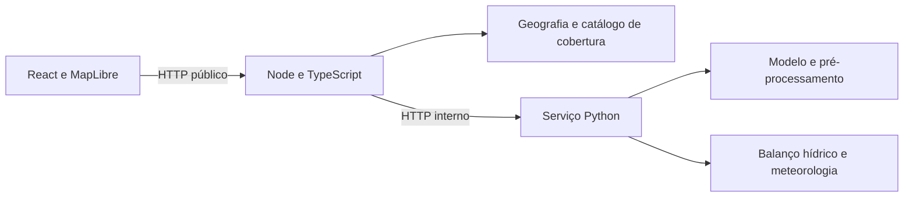

# Gaiapus — integração entre frontend, Node e Python

**Escolha a opção 3 — Python code / model files.** A equipe de dados entrega código Python, artefatos de modelo, schemas JSON e exemplos. O serviço HTTP interno será o adaptador entre o backend Node e o motor Python. A equipe pode iniciar com os exemplos versionados em `contracts/examples/`.

## Entrega da equipe de dados

| Recurso | Uso |
|---|---|
| `data/serving/products.py` | Montagem das respostas de rendimento e projeção hídrica |
| `data/serving/build_examples.py` | Carregamento dos modelos e geração dos exemplos |
| `data/models/water_balance.py` | Motor físico |
| `data/models/research_v6/` | Artefatos locais de pesquisa para soja e milho safrinha |
| `contracts/` | Schemas de saída e fixtures |
| `gaiapus-mvp/` | Protótipo React/MapLibre com globo e recortes históricos |

Os exemplos de rendimento usam features históricas já calculadas. Para uma safra nova, a equipe científica precisa entregar o construtor de features que reproduz o treino, os artefatos com manifesto e dependências e um caso real reproduzível. O clone fornece código, schemas e fixtures. Combine a transferência dos binários à parte.

## Python

- Crie um adaptador HTTP pequeno e persistente, por exemplo FastAPI. A equipe científica mantém o pré-processamento, a seleção do corte, a inferência, o simulador e as métricas.
- Carregue os artefatos confiáveis na inicialização, confira manifesto e hashes e reproduza a inferência em processo novo. Rode aquisição e treino fora das requisições do app.
- Valide cultura, município, cobertura e horizonte antes de invocar os helpers. O `water_response` atual indexa tabelas de cultura e limites antes de tratar uma cultura inválida. Valide também continuidade, datas e unidades das séries.
- Resolva a coordenada pelo catálogo municipal. Use UTC conforme as séries. Confirme que a versão da previsão usada corresponde à emissão informada e estava disponível na decisão.
- Preserve `yield_effect: null` na projeção hídrica. Soja e milho safrinha são o escopo dos modelos v6. Habilite novas culturas pelo catálogo conforme a avaliação entregue.

## Node e TypeScript

O Node expõe a API ao navegador, valida entradas e saídas, resolve IDs, consulta cobertura e chama Python pela URL interna configurada no ambiente. Use os schemas de `contracts/` como referência e defina os esquemas de entrada junto com a equipe científica. As rotas abaixo são propostas.

| Rota | Responsabilidade |
|---|---|
| `GET /v1/geography` | Busca por nome, navegação por ID pai e limites para a câmera |
| `GET /v1/coverage?area_id=...` | Produtos, culturas, períodos, cortes e horizontes disponíveis e motivos de indisponibilidade |
| `GET /v1/observations` | Chuva, NDVI e imagem por recorte e período |
| `POST /v1/yield-estimates` | Município, cultura e referência da safra. Retorna o schema de rendimento |
| `POST /v1/water-balance/scenarios` | Município, cultura, semeadura, decisão e dias à frente. Retorna o schema hídrico |
| `GET /health` | Estado do serviço e dependências essenciais |

- Suporte modos explícitos `fixture` e `live`. Identifique a origem da resposta. Preserve o código IBGE como string. Use 422 para entrada inválida, 404 para ID inexistente e 503 para dependência indisponível. Represente uma área válida sem análise com estado de domínio e motivo.
- Configure timeout entre Node e Python. Registre duração, versão, ID de requisição e tipo de falha. Use cache de histórico por área, período e versão. Para projeções, inclua a emissão meteorológica e os parâmetros na chave de cache. Guarde credenciais no servidor.

## Frontend React e MapLibre

1. Implemente **globo → país → estado → município → recorte publicado**. Comece por Brasil → MT → Sorriso. Enquadre a câmera, mantenha breadcrumb e ofereça busca ou lista como alternativa a WebGL. Ao trocar de município, limpe o painel e cancele chamadas antigas. A cobertura vem da API por produto e área.
2. No histórico, mostre imagem HLS datada, contorno, chuva e NDVI onde publicados. Alinhe gráficos no tempo e indique fonte, escala e unidade. Preserve lacunas e zeros observados. Uberlândia tem exemplo de recorte histórico no protótipo.
3. Em rendimento, mostre colheita estimada em kg/ha, corte usado em dias após semeadura, safra, hipótese de calendário, modelo, data máxima dos insumos e escopo da métrica. Exiba MAE como medida agregada de avaliação. Trate `before_first_cutoff` e `not_supported` sem inventar valores.
4. Em projeção hídrica, use um seletor separado de dias à frente. Habilite por padrão o limite avaliado retornado pelo serviço. O recorte documentado avaliou até sete dias contra a série de menor antecedência do mesmo provedor. Mostre emissão, hipótese de solo, dias solicitados e servidos, reserva, déficit e estresse. O fixture N10 serve para verificar `partially_validated`.
5. Reserve espaço para comparar estratégias de cultivo e cobertura no Field Shift. Mostre hipóteses, prioridades do produtor e trade-offs quando a equipe entregar o cenário correspondente.

Inclua carregamento, sem cobertura, resposta parcial e falha temporária. Garanta foco visível, fluxo por teclado e tabela ou resumo textual para gráficos.

## Ordem de implementação

1. Faça o fluxo React → Node com fixtures. Teste Sorriso com soja e milho no dia 75, Uberlândia com soja no dia 20 e a projeção N10.
2. Implemente o adaptador Python e conecte o Node. Reproduza os exemplos com insumos e artefatos equivalentes, comparando valores, datas, unidades e schema.
3. Teste troca rápida de município, área sem cobertura, cultura inválida, dados incompletos, horizonte acima do suportado e timeout. Confira desktop, celular e teclado.
4. Entregue README com inicialização dos serviços, configuração, modos fixture/live e requisitos dos artefatos. Mostre a origem, a safra e o escopo de cada resultado na demonstração.

Referências: [arquitetura do MVP](gaiapus-25-arquitetura-front-back.md) e [resultados e contratos v6](gaiapus-26-v6-produtos-e-contratos.md).
