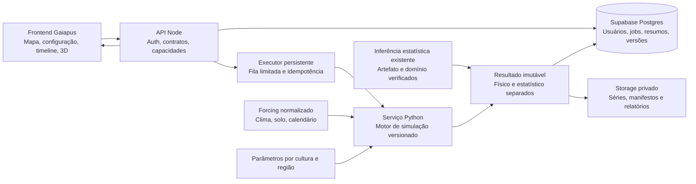
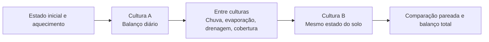
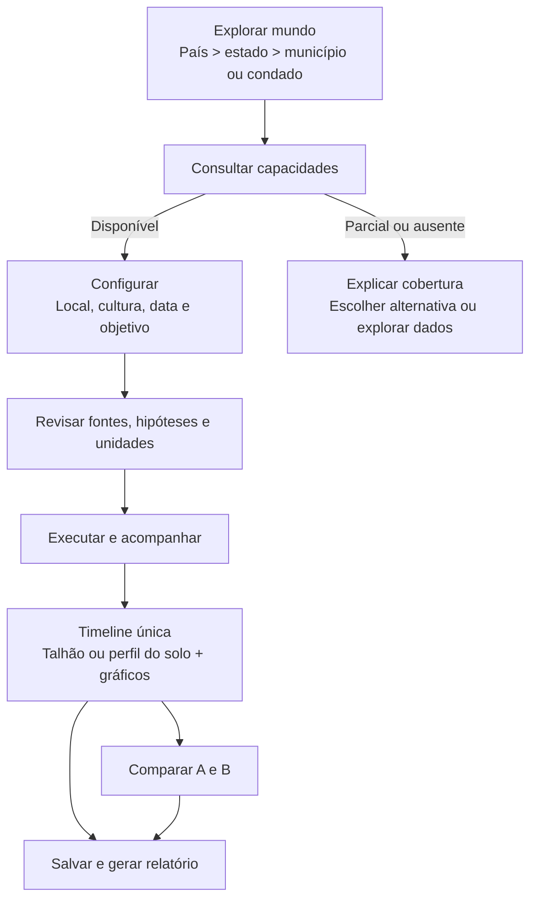

# Especificação da simulação integrada

Status: proposta técnica para implementação. Decisões fundamentadas na auditoria de 15/11/2026, não em uma comparação de precisão agronômica entre os motores.

## 1. Resultado esperado para o agricultor

A pessoa escolhe uma localidade ou talhão, informa o que já plantou ou deseja plantar, verifica as suposições e compara cenários. Vê no mesmo dia da timeline: estágio, chuva, demanda de água, água disponível, irrigação, déficit e alertas. Pode consultar rendimento e margem quando houver método e dados compatíveis, sempre com sua origem e limitações.

A resposta principal deve ser compreensível: “Neste cenário, o período mais crítico foi o florescimento; a alternativa B reduziu os dias de estresse, com esse consumo de água e esse custo”. Não converter automaticamente isso em garantia de safra ou prescrição de manejo.

### Três resultados independentes

| Resultado | Como é calculado | Como apresentar |
|---|---|---|
| Balanço hídrico e fases | Motor físico simplificado, clima, solo e manejo | Água em mm, fases e hipóteses; indicar parâmetros estimados |
| Rendimento estatístico | Modelo/referência compatível com cultura, região, corte e disponibilidade | kg/ha municipal, método e status de validação; intervalo só se calibrado |
| Crescimento 3D | Tradução visual do estado diário disponível | Ilustração do cenário; não gêmeo digital medido |

O motor pode ter também um rendimento **físico exploratório** com resposta hídrica e potencial informado. Esse resultado fica separado do MLP e da referência histórica. Não multiplicar previsão do MLP por um fator de seca sem protocolo específico: as entradas do MLP já podem conter clima e déficit, causando dupla penalização. Comparar intervenções no motor não demonstra causalidade observacional do MLP.

## 2. Arquitetura recomendada



Manter a API Node como fronteira pública. Python recebe pedidos internos normalizados e nunca uma URL arbitrária para baixar arquivos. A API resolve localização, permissões, dados e versões. O código científico compartilhado pertence ao repositório científico; o produto incorpora uma distribuição versionada ou snapshot com manifesto, seguindo o mecanismo de pin existente.

Evitar criar motores definitivos em dois repositórios. Durante o desenvolvimento, a especificação e os contratos ficam no Gaiapus-APP; a implementação numérica canônica fica em `data/models/crop_simulation/` no repositório científico. O serviço Python do produto funciona como adaptador. Gerar seu pacote a partir de uma revisão identificada, nunca editar uma cópia vendorizada e esquecer a origem.

### Incrementos independentes

1. **Visualização:** scene adapter sobre os resultados já disponíveis. Nenhum recálculo necessário. Campos ausentes permanecem desconhecidos.
2. **Simulação histórica auditada:** nova versão do motor, forcing congelado, correções H01–H06, soja e milho.
3. **Cenários e economia:** ensembles pareados, irrigação, rotação e margens com unidades explícitas.
4. **Café:** módulo perene e capacidades graduais, sem reutilizar um ciclo anual genérico.
5. **Operação e expansão:** forcing disponível no corte, observações reais, novos países/culturas conforme evidência.

Cada incremento usa uma capacidade específica e pode ser desligado sem remover a tela nem alterar resultados antigos.

## 3. Modos e limites temporais

| Modo | Entrada climática | Mensagem obrigatória | Uso |
|---|---|---|---|
| Histórico | Dados de uma safra concluída, com versão | Reprodução retrospectiva | Explicar eventos passados |
| Ensemble histórico | Mesma decisão repetida em anos históricos elegíveis | Distribuição histórica de cenários | Avaliar sensibilidade à variabilidade |
| Sensibilidade | Histórico/ensemble modificado explicitamente | Cenário hipotético: por exemplo chuva −20%, temperatura +1,5 °C | Comparar respostas sob hipóteses |
| Previsão curta | Emissão de previsão identificada, dentro do horizonte disponível | Previsão emitida em X, válida até Y | Risco hídrico de curto prazo |
| Horizonte longo | Análogos/climatologia ou conjunto de trajetórias | Cenários, não previsão diária do tempo | Planejamento de ciclo e perenes |

Um pedido “simular café pelos próximos três meses” pode mostrar três meses de uma lavoura adulta ou de implantação. Não significa prever o tempo diário por 90 dias nem colher um café recém-plantado nesse intervalo.

Todos os dias possuem `forcing_kind` e origem. A transição observado → previsto → cenário deve ser visível no gráfico e no relatório. Não emendar fontes com uma linha contínua sem indicar a mudança.

## 4. Contratos: proposta nova, sem substituir os existentes

Os nomes abaixo são **novos contratos propostos**, não endpoints atualmente disponíveis.

### API pública

- `GET /v1/simulations/capabilities?location_id=...`: culturas, modos, períodos, manejos, campos necessários, métodos disponíveis e motivos de indisponibilidade.
- `POST /v1/simulations`: valida um pedido, grava a identidade e retorna `202` com `simulation_id` e estado. Pode devolver resultado pronto de cache autorizado.
- `GET /v1/simulations/:id`: status, resumo e referências dos resultados do proprietário.
- `GET /v1/simulations/:id/daily?member_id=...`: série diária paginada/compacta de um membro do ensemble.
- `POST /v1/simulations/:id/cancel`: cancelamento cooperativo, sem prometer matar imediatamente uma operação não cancelável.
- `POST /v1/simulations/:id/report`: gera relatório a partir do resultado autorizado no servidor.

Comparações podem usar os mecanismos atuais de snapshots, estendidos por migração, referenciando IDs imutáveis de simulação. Não aceitar “resultado calculado” arbitrário enviado pelo browser como verdade científica.

### Pedido canônico

```typescript
type SimulationMode =
  | 'historical_replay' | 'historical_ensemble'
  | 'sensitivity' | 'short_forecast' | 'climate_scenario';

interface SimulationRequestV1 {
  schema_version: 'crop-simulation-v1';
  location_id: string;         // BR:ibge:5107925 ou US:fips:19169
  field_id?: string;           // Resolvido e autorizado no backend
  mode: SimulationMode;
  decision_at?: string;        // Obrigatório em modos operacionais, ISO UTC
  crop_plan: CropPlanItem[];
  soil_profile_id: string;     // Versão + origem verificáveis
  initial_water: InitialWaterSpec;
  forcing_selection: ForcingSelection;
  management: ManagementSpec;
  economics?: EconomicsSpec;
}
```

Definir os tipos discriminados no JSON Schema. Não usar objetos livres para manejo, fonte ou parâmetros. O servidor valida que perfil/localidade/cultura são compatíveis; `owner_id`, status científico, hashes e permissões nunca são escolhidos pelo cliente.

`CropPlanItem` deve conter `crop_id`, `parameter_set_id`, `sowing_date` ou regra anual válida, `management_system` e, para perenes, idade, estágio inicial e histórico necessário. Mapear `maize_safrinha` do Lara para `maize2`. Rejeitar `coffee` ambíguo e `coffee_total_mg` como cultivo: pedir arábica/conilon e o sistema adequado.

Datas completas usam ISO `YYYY-MM-DD`. Regras recorrentes de mês/dia são validadas para cada ano do ensemble. `29/02` em anos não bissextos exige política explícita e registrada: rejeitar ou excluir aquele membro, sem deslocar silenciosamente. Intervalos fora do catálogo, excesso de anos, culturas sobrepostas ou parâmetros não finitos produzem erro estruturado.

### Resultado e semântica

O envelope inclui:

- `simulation_id`, versão do schema, modo, data de criação e dono resolvido no servidor;
- entrada normalizada, localização, geometria/representatividade e unidades;
- revisão do motor, conjunto de parâmetros, snapshot de forcing e hashes;
- status do cálculo e capacidades realmente executadas;
- qualidade/cobertura, anos incluídos e excluídos com motivos;
- resultados físicos, estatísticos e econômicos separados;
- proveniência e limitações em códigos estáveis para tradução;
- membros históricos e resumos, sem carregar todos os dias no primeiro payload;
- recomendações de manejo somente quando houver regra identificada e sustentada.

Uma linha diária deve oferecer ao menos:

`date`, `crop_id`, `phase_code`, `days_after_sowing`, `precipitation_mm`, `irrigation_net_mm`, `irrigation_gross_mm`, `et0_mm`, `etc_mm`, `eta_mm`, `storage_mm`, `capacity_mm`, `runoff_mm`, `drainage_mm`, `stress_coefficient`, `mass_balance_residual_mm`, `quality_flags`.

Campos adicionais como `root_depth_m`, `canopy_fraction`, `soil_layer_water` e `temperature_max_c` só são preenchidos quando sustentados pelo método. O schema diferencia campo ausente/nulo de zero físico. O scene adapter recebe nulos e oculta a informação, em vez de fabricar valores.

Status científicos separados do status técnico:

- técnico: `queued`, `running`, `ready`, `failed`, `cancelled`;
- evidência: `illustrative`, `physical_experimental`, `retrospective_evaluated`, `prospective_approved` conforme catálogo real;
- rendimento: `statistical_model`, `historical_reference`, `physical_sensitivity` ou `unavailable`.

Não inventar `prospective_approved` porque o job executou. Preservar os detalhes existentes de teste/escopo, mesmo quando o método servido não foi superior à referência.

Erros úteis: `LOCATION_UNSUPPORTED`, `CROP_UNSUPPORTED`, `MODE_UNSUPPORTED`, `INVALID_DATE`, `OVERLAPPING_CROPS`, `FORCING_INCOMPLETE`, `SOURCE_NOT_AVAILABLE_AT_CUTOFF`, `SOIL_PARAMETERS_REQUIRED`, `MODEL_OUT_OF_DOMAIN`, `RESOURCE_LIMIT`, `RESULT_NOT_FOUND`. Respostas explicam a ação possível, sem expor resultados de outro usuário.

## 5. Forcing, limpeza e rastreabilidade

### Reaproveitar a ingestão já existente

Começar pelos arquivos normalizados do projeto. Não abrir um segundo downloader global dentro do simulador. Para NASA POWER, usar a [API diária oficial](https://power.larc.nasa.gov/docs/services/api/temporal/daily/), fixando parâmetros, coordenada/pixel, unidade, período e padrão temporal no manifesto. A API entrega produtos em suas resoluções originais; um ponto municipal não vira observação de talhão.

O Lara usa `PRECTOTCORR`. A ingestão geográfica Gaiapus inspecionada solicita `IMERG_PRECTOT`; outros pipelines trabalham com IMERG Early/Late/Final. **Esses nomes não autorizam tratar tudo como uma série única equivalente.** Registrar fornecedor, produto, variável, versão, resolução, método de agregação e atualização. Uma troca de chuva exige experimento de sensibilidade documentado; não calibrar correção usando o teste de rendimento já aberto.

ET0 deve ter método e entradas versionados. Não trocar radiação, pressão, ponto de orvalho e umidade relativa sem identificar a alteração. Se usar fallback, retornar `method_variant` e qualidade. Conversões, como energia diária e velocidade do vento, devem ser testadas com unidades explícitas.

### Regras mínimas de dados

1. Chave única por local/pixel, fonte/versão, variável, dia e padrão temporal.
2. Ausente não é zero; sentinelas tornam-se nulos com flag.
3. Validar continuidade, faixas físicas e `Tmin <= Tmax` antes do motor.
4. Operacional: nenhuma observação ou revisão posterior ao corte pode entrar. Para previsão, guardar emissão, validade e recebimento.
5. Retrospectivo: permitir preenchimento somente por política declarada, com comprimento máximo da lacuna, método e fração afetada. O primeiro release usa modo estrito e exclui membros incompletos; não inventar um limite “científico” sem avaliação.
6. Para disponibilidade histórica desconhecida, marcar `unknown` e impedir que o resultado seja apresentado como reprodução operacional.
7. Não substituir chuva ausente por climatologia silenciosamente. Uma alternativa deve ser um cenário identificado.
8. Armazenar `observed_at/valid_at`, `issued_at` quando aplicável, `available_at` comprovado/estimado/desconhecido e `retrieved_at` separadamente.
9. Conservar hashes de arquivos normalizados e referências aos brutos necessários à reprodução.
10. Coordenadas, arredondamento e chave de cache seguem a mesma resolução declarada. Cache inclui parâmetros, versão da fonte, janela, padrão temporal e hash de conteúdo.

NDVI/HLS e imagem real entram como contexto de observação e comparação onde há dados validados. Não transformar NDVI em rendimento ou absorção de água sem modelo calibrado. Leituras IoT reais têm dispositivo, profundidade, calibração, unidade, qualidade e data; nunca compartilhar o mesmo rótulo visual com sondas virtuais.

## 6. Motor hídrico e rotação

A [FAO-56, capítulo 8](https://www.fao.org/4/X0490E/x0490e0e.htm) fornece a base para água disponível, estresse e balanço na zona radicular. A implementação deve explicitar a simplificação adotada; a referência não valida automaticamente seus parâmetros ou a previsão de rendimento.

### Invariantes do novo motor

- Todos os fluxos e estados em mm sobre área unitária; profundidade em m e teor volumétrico em m³/m³.
- Armazenamento entre limites físicos; ETa não excede a água extraível na etapa.
- Identidade diária: estado inicial + entradas − saídas − estado final = resíduo, incluindo fluxos de fronteira associados a mudanças de domínio.
- Arredondamento apenas na apresentação; cálculos e auditoria em float64.
- Ordenação diária documentada e testada para chuva, irrigação, escoamento, drenagem e ET.
- Zero ET0, seca prolongada, chuva extrema, irrigação excessiva, ano bissexto e ciclo entre anos não geram NaN ou água artificial.
- A capacidade e os parâmetros nunca mudam implicitamente porque a cultura mudou.

### Raízes e perfil

Para a primeira integração visual, mostrar raízes apenas se o resultado contém profundidade ou se a animação estiver explicitamente identificada como ilustrativa. O bucket antigo não sustenta sondas de 15/40 cm como valores por camada.

Para o motor novo, preferir um perfil de solo de profundidade fixa com poucas camadas e água conservada. A profundidade radicular controla o acesso à água; o solo abaixo das raízes continua existindo. Isso facilita a transição de culturas sem apagar déficit. Se a primeira versão usar uma única camada, expor apenas a média da zona radicular, mantendo desconhecido o perfil vertical.

Não adicionar infiltração sofisticada ou Richards somente para tornar o 3D mais detalhado. A complexidade física deve corresponder aos parâmetros disponíveis e aos testes.

### Calendário contínuo



Calcular todos os dias desde o início do aquecimento até o fim da simulação. Aquecimento pode usar forcing anterior; se insuficiente, expor a condição inicial como hipótese e quantificar sensibilidade. Não usar sempre solo na capacidade de campo sem avisar.

Sequência simples rejeita sobreposição. Consórcio milho–braquiária requer representação específica de competição e cobertura, ou permanece cenário ilustrativo do produto existente. Não transformar soma de dois cultivos independentes em simulação de consórcio.

Cobertura do solo é medida sobre a união dos dias no intervalo real. Erosão, carbono, nutrientes, fixação de N e recuperação do solo ficam como indicadores qualitativos referenciados até existirem módulos e dados próprios. Balanço de água sozinho não calcula esses impactos.

## 7. Ensemble e economia

Para comparar A e B, usar a mesma localização, origem climática, anos elegíveis e estado inicial. Registrar mudanças intencionais de solo/manejo. Se um membro falha, excluí-lo de ambos para métricas pareadas e informar a perda de cobertura.

Apresentar P10/P50/P90 de cada alternativa e também P10/P50/P90 de `B − A`, calculados por safra antes dos percentis. Mostrar número de membros, frequência histórica de estresse e anos representativos. Frequência em 24 anos históricos não é probabilidade calibrada do clima futuro. Percentis climáticos não são intervalo de confiança do MLP.

Escolher anos representativos por regra registrada, com ID estável; o usuário pode trocar para qualquer membro. Em uso operacional, não selecionar um ano “seco” com base no desfecho futuro observado.

Economia opcional:

- rendimento em kg/ha e produção total somente se área informada;
- preço com moeda, unidade (`kg`, saca de peso declarado), região e data;
- receita, custos fixos/variáveis, irrigação e margem por hectare;
- irrigação em mm: 1 mm em 1 ha = 10 m³; custo por m³ não pode ser aplicado diretamente a mm;
- ponto de equilíbrio e frequência de margem negativa por membro;
- inflação/ano-base identificados se usar preços históricos;
- separação entre valor informado pelo usuário e fonte externa.

Quando não há rendimento adequado, apresentar custo e consumo de água, deixando margem indisponível. Não usar zero como substituto. Não anunciar “melhor lucro” comparando preços de moedas/anos diferentes.

## 8. UX integrada

Preservar tema, tipografia, navegação, componentes e traduções atuais. Portar a hierarquia visual do Lara sem substituir toda a aplicação.

### Fluxo



### Layout da tela

- Cabeçalho: localidade/breadcrumb, cultura, modo, período e estado de evidência.
- Configuração: localização já preenchida a partir do mapa; cultura e data como campos principais. Solo e manejo têm resumo com origem; ajustes avançados ficam recolhidos, não removidos.
- Área central: alternância “Talhão” / “Perfil do solo” / “Gráficos”. No mobile, uma vista pesada por vez.
- Painel diário: fase, chuva, água no solo, ET0/ETa, estresse, irrigação e alerta principal. Unidades e qualidade acessíveis.
- Timeline única: calendário, fases, marcador de hoje/corte, mudança de fonte, play/pause, velocidade e navegação por fase.
- Abas de resultados: Água; Produção; Economia; Fontes e hipóteses. Uma aba pode explicar indisponibilidade sem desaparecer.
- Comparação: A e B lado a lado em números e gráfico; mesmo dia e membro climático. Um único canvas no mobile, alternando a alternativa.
- Salvamento: nome, notas, cenário e versão. Editar entrada cria nova execução; não reescrever resultado antigo.

### Onboarding e acessibilidade

Tutorial contextual curto, dispensável e reabrível: (1) local/cultura; (2) tipo de cenário; (3) timeline e fase; (4) comparação; (5) fontes/limitações. Reaproveitar `tours/`, sem novo overlay que esconda ações.

Tabulação e leitor de tela alcançam controles; gráficos têm resumo textual/tabela. Cor não é o único indicador de seca/risco. Respeitar movimento reduzido, pausar animação em aba oculta e oferecer 2D se WebGL falhar. Erros de rede preservam entradas, identificam se o resultado exibido ficou desatualizado e permitem tentar novamente.

Português, inglês, espanhol, francês e alemão traduzem rótulos, alertas, fases, tutorial e relatórios. Localização não muda o cálculo: trocar idioma não deve disparar nova simulação. Formatação decimal/data/moeda usa o locale; o contrato permanece canônico. Auditar também o schema de preferências do backend, que pode ter cobertura de idiomas menor que o frontend.

O mapa continua global. Fonte climática disponível não implica cultivo parametrizado, rendimento validado ou solo medido. Capacidade deve ser por **local × cultura × modo × produto × período**, não um booleano “tem dados”. No caso americano, manter hierarquia estado → county e IDs FIPS, sem chamar condado de cidade.

## 9. Culturas e fases de expansão

| Etapa | Entrega | Condição para habilitar |
|---|---|---|
| A | Soja/Sorriso: visualização integrada dos resultados atuais | Preservar números e status; nenhum campo fictício |
| B | Soja/Sorriso e Uberlândia: novo cenário histórico físico | Forcing íntegro, solo/calendário versionados, motor corrigido |
| C | Milho safrinha e sequência soja–milho | Calendário contínuo, pousio e transição de raízes testados |
| D | Café arábica MG: lavoura adulta e implantação separadas | Parâmetros perenes e cronologia próprios; rendimento pode continuar indisponível |
| E | Conilon, milho 1ª, feijão, trigo, arroz e regiões US | Revisão específica de sistema produtivo, calendário e fontes |

Para café, a literatura descreve um ciclo fenológico de frutificação do arábica que envolve dois anos; isso impede modelá-lo corretamente como uma cultura anual genérica de 365 dias. Ver [Camargo e Camargo, Bragantia, 2001](https://www.scielo.br/j/brag/a/DHJFXMkTxK5wJX5q74xhw3p/?lang=pt).

O módulo de café precisa diferenciar idade/implantação de lavoura adulta, fase inicial, safra anterior quando pertinente, poda e irrigação, e parametrizar região/espécie. Modelar o efeito de cada manejo apenas quando houver equações e parâmetros revisados. Uma janela de 90 dias é um recorte temporal, não necessariamente o ciclo produtivo. Bienalidade não pode ser inventada alternando alto/baixo por ano par/ímpar.

Arroz irrigado demanda representação de lâmina/sistema de cultivo; trigo de inverno pode depender de frio/vernalização e calendário próprio. Ter um modelo estatístico municipal dessas culturas não resolve essas lacunas do simulador físico.

## 10. Supabase e hospedagem

Aplicar migração aditiva, compatível com os contratos atuais. Manter Postgres para dados transacionais e consultáveis; não inserir rasters globais ou cada frame 3D no banco.

### Estruturas propostas

| Estrutura | Conteúdo | Observação |
|---|---|---|
| `simulation_runs` | ID, owner, local, cultura, modo, estado, input normalizado, hashes, resumo, timestamps | Índices por owner/data e estado de job; RLS |
| `simulation_artifacts` | Run, tipo, caminho privado, hash, tamanho, schema | Sem duplicar séries grandes no JSON de cada tabela |
| catálogo versionado | Capacidades, parâmetros e fontes | Reutilizar catálogo existente quando possível |
| comparação existente | Referências a runs imutáveis e notas | Estender enum/check por migração, sem quebrar snapshots antigos |
| observações de safra | Plantio real, manejo, colheita, preço e qualidade | Dados do usuário separados dos resultados simulados |

`simulation_runs` não deve confundir resultado imutável com status mutável de execução. Encerrar a execução grava um resultado fechado; nova hipótese gera novo run. Definir política de expiração, cancelamento, retries, idempotência e recuperação após reinício. Não depender apenas de `ResultHandleStore` em memória com TTL para jobs longos.

Postgres protege as linhas por proprietário usando RLS; Storage protege os objetos de resultado e emite URLs curtas quando necessário. Ver [documentação de RLS do Supabase](https://supabase.com/docs/guides/database/postgres/row-level-security). O backend verifica pertencimento de campo, cenário e resultado; não confiar em `owner_id` do browser. Chave privilegiada nunca vai para o frontend.

### Retenção e consumo

- Produção quente: política previamente acordada de **24–36 meses de clima e 10 anos de rendimentos**, sujeita à auditoria das dependências de cada modelo.
- Ensembles históricos precisam de mais anos. Guardar forcing antigo normalizado e compacto, por local/pixel e versão, em Storage/arquivo de pesquisa; carregar sob demanda ou oferecer cenários pré-calculados. Não fingir ensemble de 24 anos com só três anos disponíveis.
- Resultados diários: Parquet comprimido no arquivo de longo prazo; JSON compacto de um membro/janela para o frontend. Medir tamanhos e tempo de leitura antes de escolher codec/particionamento.
- Cache de cálculo inclui fonte, versão, parâmetros e entradas; locale e câmera não invalidam a ciência. Não compartilhar entradas privadas entre usuários por cache global.
- Não arquivar enquanto um modelo, relatório, registro prospectivo ou reprodução depender dos arquivos. Verificar hashes e equivalência antes de qualquer remoção, que não faz parte desta integração.

Workers Python carregam somente as localidades e janelas necessárias. Começar com concorrência limitada e fila persistente, evitando multiplicar modelos em muitos processos. Não adicionar GPU ao serviço de balanço hídrico por padrão; é uma decisão de benchmark, distinta do treino.

## 11. Metas de aceitação e limites

Metas iniciais de engenharia, **ainda não medidas**: ensemble quente de 24 safras em CPU com mediana até 3 s e p95 até 10 s no hardware documentado; RSS de um worker até 512 MiB para esse caso; sem carregar mapas/3D em telas que não os utilizam. Medir antes de ajustar metas e justificar qualquer exceção.

Cena: renderizar sob demanda quando pausada, reduzir partículas e instâncias no mobile, liberar geometrias/texturas e não manter dois loops WebGL desnecessários. Buscar p95 de frame até 33 ms no aparelho móvel de referência e 16,7 ms no desktop de referência; registrar ambos, sem prometer desempenho universal.

A liberação exige quatro verificações independentes:

1. Integridade numérica e temporal do motor.
2. Compatibilidade dos contratos e isolamento dos usuários.
3. Consistência UX: mesmos valores, dia, cenário e unidades em todas as vistas.
4. Evidência científica declarada corretamente. Sem observação de talhão, o produto continua sendo uma simulação explicativa com hipóteses, não uma previsão validada de lavoura individual.
