<p align="center">
  
</p>

# Gaiapus

**NASA Space Apps Challenge 2026** · Challenge *Field Shift: Adapting Farms with NASA Data*

Gaiapus is a web application that shows a grower what the open data says about one place: the weather it has had, the water its soil can hold through a crop season, how different crop sequences use that water, and what the coming seasons may look like. Every number on screen says where it comes from and whether it is a measurement, a historical simulation, a forecast or a scenario.

**Live:** <https://gaiapus.space> · no account needed to explore.

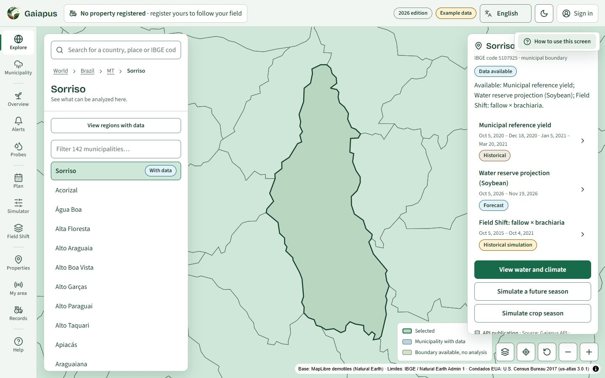

> The tool explains and compares. The decision belongs to the grower and the local agronomist.

---

## Contents

- [What you can do](#what-you-can-do)
- [What is measured, simulated or assumed](#what-is-measured-simulated-or-assumed)
- [How it was built](#how-it-was-built)
- [Data sources](#data-sources)
- [Run it locally](#run-it-locally)
- [Repository layout](#repository-layout)
- [Limits](#limits)
- [AI assistance](#ai-assistance)
- [Documentation](#documentation)

---

## What you can do

### 1. Choose a place on the map

Start from the world, pick a country, a state and a municipality or county. The panel says what can be analysed there and what cannot. Brazil and the United States share the same journey.

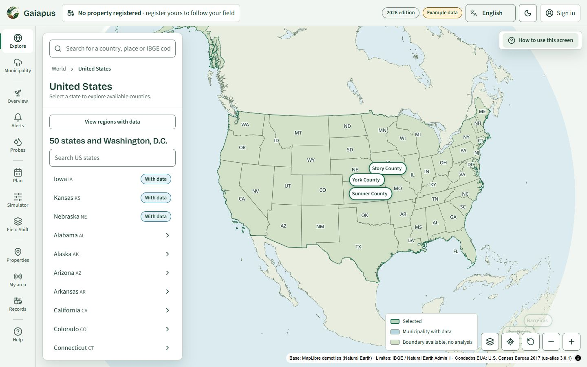

### 2. Read the place

Climate day by day, soil water, a water outlook for the coming days and, where a demonstration clip is published, vegetation index (NDVI) from satellite scenes aligned with rain.

| Overview | Municipality |
|---|---|
| 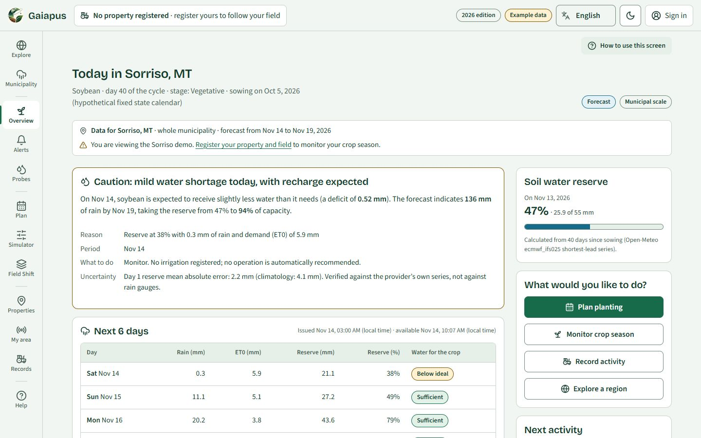 | 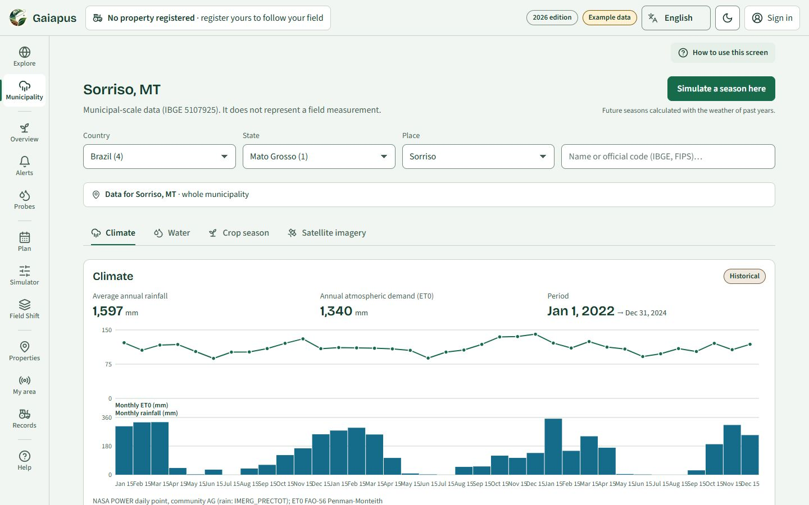 |

### 3. Simulate a future season

Pick a crop and a harvest year (2027 or 2028). The simulator runs a daily soil-water balance over 22 climate trajectories built from historical years, and reports the low, middle and high outcomes (P10 · P50 · P90) instead of a single line. Calculated today for 4 municipalities in Brazil (Sorriso, Uberlândia, Rio Verde, Barreiras) and 245 counties in Iowa, Kansas and Nebraska.

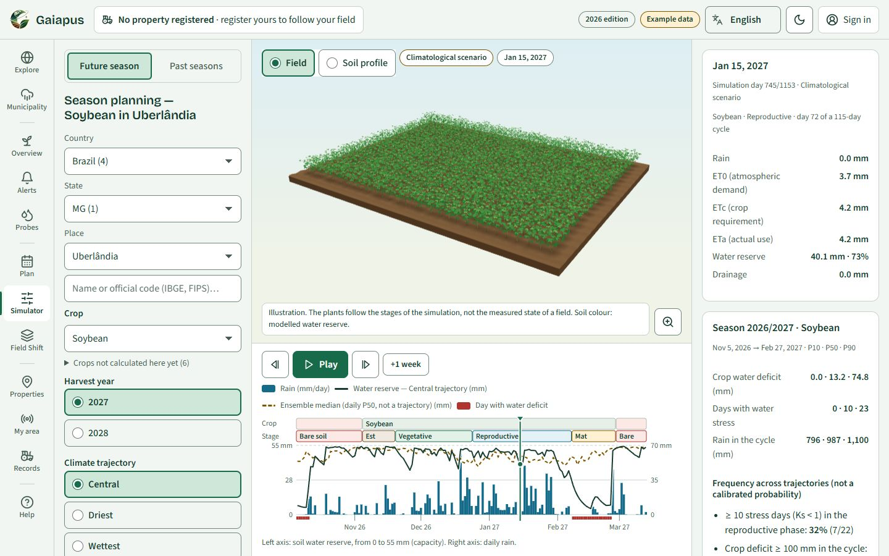

The field and the soil profile are drawn in 3D. Plants are generated from the crop stage of the simulation, and the soil colour follows the modelled water reserve. The picture is an illustration of the simulated state, not a photo of a field.

| Soil profile with the Gaiapus stake | Dark theme |
|---|---|
| 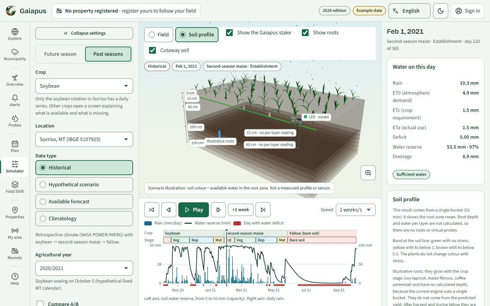 | 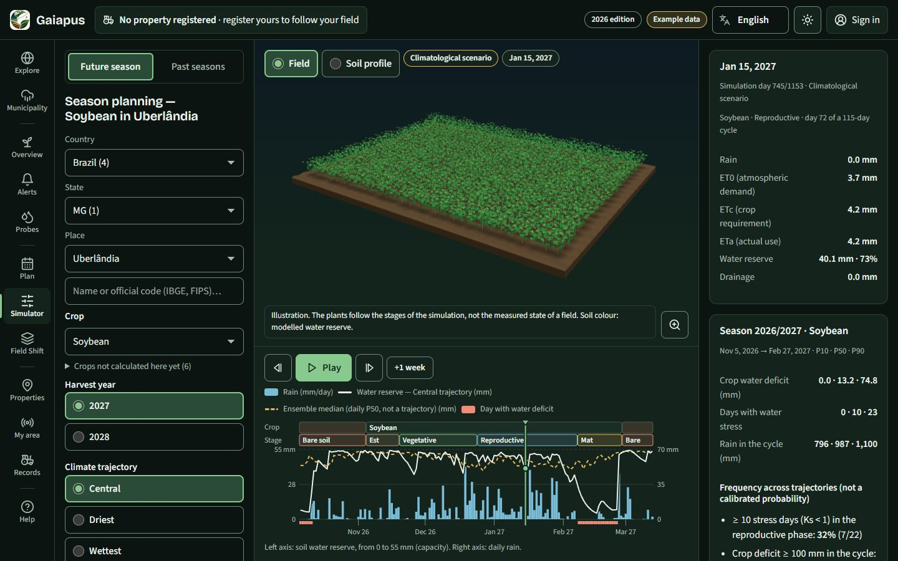 |

### 4. Compare crop sequences (Field Shift)

Three strategies after soybean in Sorriso, over six historical seasons: maize then fallow, maize with brachiaria as a cover crop, or a long fallow. Each card says why a grower would choose it, what the simulation shows, the evidence, the gaps and the risks to review on site. The grower's priority (margin, production, soil and water conservation) reorders what is read first and never changes a number.

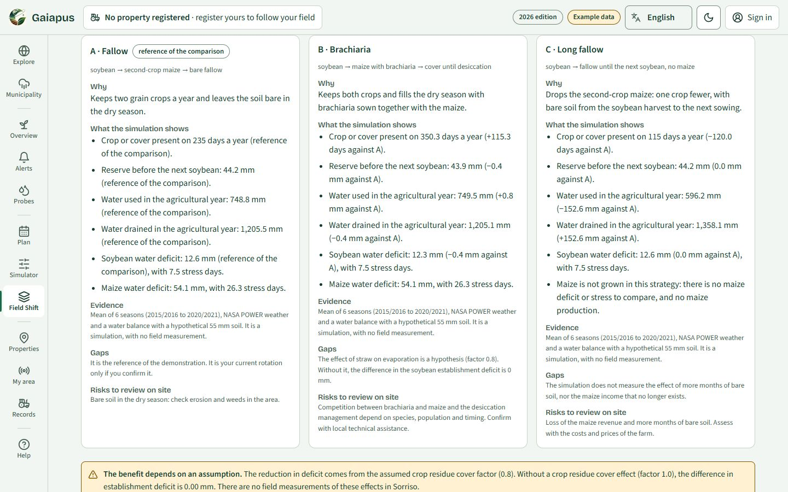

The table pairs the strategies season by season and shows the range across seasons. Rain can be tested at −20% and +20%, labelled as a sensitivity test and not as a climate forecast.

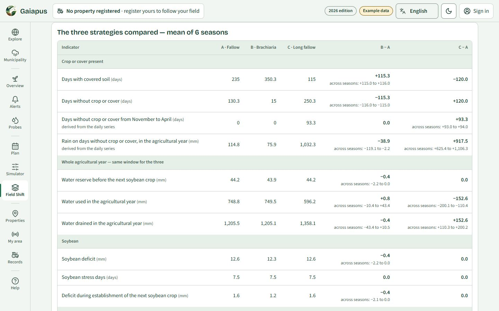

### 5. Get a technical report

Any completed simulation has a report in English, Portuguese, Spanish, French or German: identification and validity, a summary for the grower, results per crop and season, assumptions and traceability. It is assembled from the saved run by fixed rules, with no language model involved, and can be printed or downloaded as Markdown.

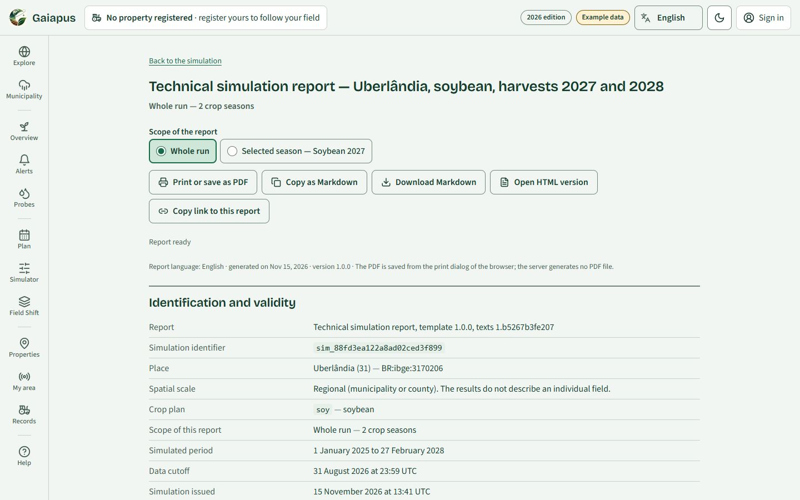

### 6. Bring your own field and the Gaiapus stake

"My area" lets a grower outline fields and register stakes. The stake is the team's low-cost solar soil probe (soil moisture and temperature at 15 and 40 cm, air, rain), designed in this repository under [`hardware/`](hardware/README.md). In the app this area is a local demonstration for now: nothing is sent to a real device, and the screen says so.

| The stake (render from the team's CAD) | Where the QR code is, in the app |
|---|---|
|  | 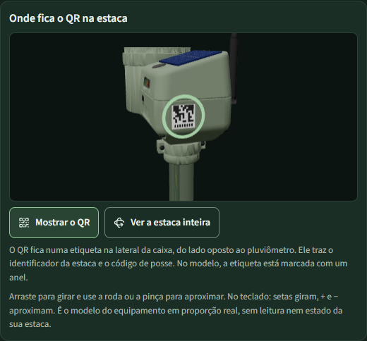 |

### Works on a phone, in five languages

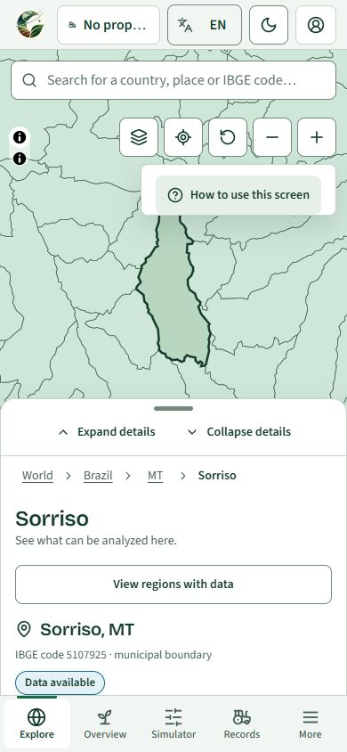

---

## What is measured, simulated or assumed

The same labels appear on every screen.

| Label on screen | What it means |
|---|---|
| **Historical** | Published statistics or weather records for past dates. |
| **Historical simulation** | A model run over past weather. Field Shift is one: a water balance, not a field trial. |
| **Forecast** | A numerical weather forecast for the next days, with its issue time. |
| **Climatological scenario** | Possible future seasons built from past years. Not a daily forecast. |
| **Example data / Local demonstration** | Published example packages, or data that lives only in the browser. |
| **Not assessed / not calculated** | No method or no data. The app says so instead of showing a number. |

What the app does **not** do: recommend a planting date automatically, turn a water difference into a yield gain, estimate erosion, or present synthetic probe readings as validation.

---

## How it was built

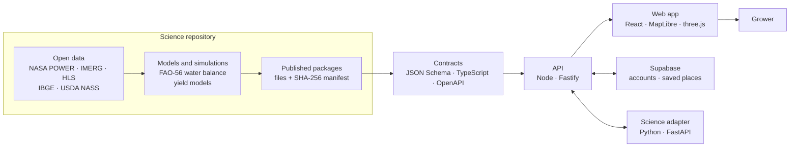

**1. Science first, as published packages.** Models and simulations are produced in a separate repository, [Gaiapus_nasa](https://github.com/LeandroJerse/Gaiapus_nasa). What reaches the app is a package: data files plus a manifest with the SHA-256 of each file, the weather input and the code that produced it. The app refuses a package whose parts do not belong together, and a test checks the bytes of the package against its manifest.

**2. Contracts between science, server and screen.** [`packages/contracts`](packages/contracts) generates JSON Schemas, TypeScript types and an OpenAPI document from one definition. `pnpm contracts:check` fails when the generated files and the definition disagree.

**3. A small API.** [`apps/api`](apps/api/README.md) is a Fastify server. Public routes serve geography, coverage, observations, published examples and simulations. Private routes (saved places and comparisons) require a confirmed Supabase account. Scientific computation that is not pre-published goes through an internal Python service, [`services/science-adapter`](services/science-adapter/README.md), which verifies model hashes at start-up.

**4. The web app.** [`apps/web`](apps/web) is React 18 with TypeScript in strict mode, built with Vite. Maps use MapLibre GL. The 3D field, soil profile and stake use three.js through React Three Fiber; plants are generated at run time from organ plans (nodes, leaves, pods, ears), so no plant model files are shipped. Screens fall back to 2D drawings where WebGL is missing. Text lives in five catalogs (pt-BR, en, es, fr, de) with a test that keeps their keys in step.

**5. Hardware.** The stake's boards, firmware, bill of materials and mechanical design are under [`hardware/`](hardware/README.md).

**6. Checks before anything is published.** As of 15 November 2026:

| Suite | Size |
|---|---:|
| Web unit and component tests (Vitest) | 600 |
| API tests | 154 |
| Contract tests | 33 |
| Browser journeys (Playwright, with accessibility checks) | 171 |

Each change goes through a pull request, SonarCloud analysis, and a deploy workflow that builds two container images, updates Azure Container Apps and runs a smoke check on the public address.

**Method.** Work followed written plans. For the scientific and comparison logic, the failing test came before the code. Each delivery keeps a record of what was verified and what was not under [`Docs/`](Docs).

---

## Data sources

| Source | Used for |
|---|---|
| **NASA POWER** (daily point data) | Weather history and the inputs of FAO-56 reference evapotranspiration |
| **GPM IMERG**, read through NASA POWER | Daily rainfall |
| **HLS v2** (Harmonized Landsat Sentinel-2) | NDVI of the published demonstration clips |
| **IBGE** | Municipal boundaries and municipal crop statistics (PAM) in Brazil |
| **USDA NASS** | County yield estimates in the United States |
| **Open-Meteo**, ECMWF IFS model | Short-range forecast for the water outlook |
| **Natural Earth**, **U.S. Census Bureau** | Base map and US boundaries |

Methods: FAO-56 Penman–Monteith reference evapotranspiration and single crop coefficient; a daily soil-water bucket; delta-change rain sensitivity; climate trajectories from blocks of analogous historical years; retrospective municipal yield models with walk-forward validation.

No NASA logos or branding are used in this project.

---

## Run it locally

Requirements: Node `22.23.4` or newer within 22.x, pnpm `10.14.0`. Python `3.13` and `uv` only if you run the science adapter.

```powershell
pnpm install --frozen-lockfile
pnpm --filter @gaiapus/contracts build

# terminal 1: API on http://127.0.0.1:3001
pnpm dev:api

# terminal 2: web app on http://127.0.0.1:5173
pnpm --filter @gaiapus/web dev
```

Public screens need no credentials. To use accounts and saved places, copy `.env.example` to `.env` and follow [Create/configure Supabase](Docs/2026-11-14-gaiapus-supabase-setup.md).

```powershell
pnpm --filter @gaiapus/web test        # web unit tests
pnpm test                              # contracts and API
pnpm typecheck

# browser journeys; needs the API and the web app running
$env:GAIAPUS_WEB_URL = 'http://127.0.0.1:5173'
pnpm --filter @gaiapus/web test:e2e
```

---

## Repository layout

```text
apps/
  web/                 React app (maps, simulator, Field Shift, reports, My area)
  api/                 Fastify API and the published data it serves
packages/
  contracts/           one definition -> JSON Schema, TypeScript types, OpenAPI
services/
  science-adapter/     internal Python service for live scientific computation
hardware/              the Gaiapus stake: boards, firmware, BOM, mechanical design
supabase/              migrations, policies and their tests
tests/e2e/             browser journeys
Docs/                  decisions, delivery records and evidence
```

---

## Limits

- Results describe a municipality or county from one weather grid point. They are not a measurement of a field.
- Soil is a fixed assumption (a class with a water capacity), not a measured profile.
- Field Shift covers one place, Sorriso (MT), and three strategies. Yield, margin, soil carbon, erosion, weeds, nitrogen and pests are not simulated.
- Future seasons are scenarios from past years. They are not a forecast, and their frequencies are not calibrated probabilities.
- Yield in future simulations is a historical reference or is unavailable; water results are labelled experimental.
- "My area" and the stake readings in the app are a local demonstration. The server has no device routes yet.
- Translations to Spanish, French and German have not been reviewed by native speakers.
- Phone layouts were checked in emulation, not on physical devices.

---

## AI assistance

In line with the NASA Space Apps rules on AI tools:

- **Code and documentation:** written with the help of AI coding assistants (Claude, by Anthropic, and Codex, by OpenAI), under the team's direction, and reviewed and tested as described above. The idea, the scientific choices and the product direction are the team's.
- **In the product:** the application calls no language model. Reports and explanations are produced by fixed rules from published data.
- **Images:** the screens in this README are captures of the published app, and the stake image is a render of the team's own CAD model. None of them is AI-generated.

---

## Documentation

- [API: start-up, routes and deployment](apps/api/README.md)
- [Science adapter: models and readiness gates](services/science-adapter/README.md)
- [Hardware: the Gaiapus stake](hardware/README.md)
- [Azure deployment: configuration and commands](Docs/azure-deploy.md) · [First unified deploy](Docs/2026-11-15-primeiro-deploy.md)
- [Create/configure Supabase](Docs/2026-11-14-gaiapus-supabase-setup.md)
- [API/frontend handoff](Docs/2026-11-14-gaiapus-api-handoff.md) · [Implementation record](Docs/2026-11-14-gaiapus-api-implementation-plan.md)
- Delivery records (Portuguese): [Field Shift and journey](Docs/sprint-final/) · [future simulations](Docs/simulacao-2027-2028/) · [technical reports](Docs/relatorios-tecnicos/) · [visual refresh and 3D crops](Docs/visual-refresh/) · [My area and stake](Docs/sensores-talhoes/) · [Field Shift rain exposure](Docs/aproveitamento-field-shift/)
