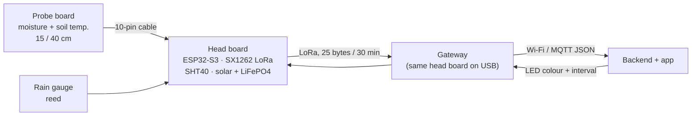

# Gaiapus · Hardware

**NASA Space Apps Challenge 2026** · *Field Shift: Adapting Farms with NASA Data* · Team Gaiapus

This folder contains the **Gaiapus soil stake**: electronics, firmware, bill of materials, mechanical CAD and renders. For the project overview, the decision engine and the app, see the [main README](../README.md).

The stake is a low-cost solar device that measures a field where satellite data is too coarse. It measures soil moisture and soil temperature at 15 and 40 cm, air temperature and humidity, and rainfall. It sends the readings over LoRa to a community gateway, and the backend uses them to correct NASA data (SMAP, GPM IMERG, POWER) for that field.

| 3D model of the stake (generated from the boards and the case) | Exploded view (rev G) |
|---|---|
| /renders/render-head-gauge-left.png) | /renders/exploded-revG.png) |

---

## Status

| Part | Status | Evidence |
|---|---|---|
| Schematics of both boards (head + probe) | complete, ERC with no errors | `hardware/gaiapus-node`, `hardware/gaiapus-probe` |
| Head PCB (90 × 50 mm, 4 layers) | routed 51/51 nets, DRC with no errors | `hardware/gaiapus-node/*.kicad_pcb`, 3D model `.glb`/`.step` |
| Probe PCB (22 × 450 mm, 2 layers) | routed 12/12 nets, DRC with no errors | `hardware/gaiapus-probe/*.kicad_pcb` |
| Bill of materials with cost | every main part with LCSC code and price | `bom/` |
| Power budget | computed from datasheet values | `power/power_budget.py` |
| Case, stake and rain gauge (rev G) | drawings, printable 3MF files, full 3D assembly, 36/36 checks passed, 0 mm³ interference | `mechanical/` |
| Stake and gateway firmware | complete, tested on a PC (9 simulated hours, network outage, resend) | `firmware/` |
| Bench prototype | ESP32 dev board + off-the-shelf sensors, same firmware and protocol | `firmware/src/main.cpp` |
| Physical PCB prototype | **not manufactured yet** | — |

## Key numbers

| | Value |
|---|---|
| Measurements | soil moisture and temperature at 15 and 40 cm, air temperature and humidity, rainfall, battery |
| MCU and radio | ESP32-S3-MINI-1 + EBYTE E22-900MM22S (SX1262), regional band 868/915 MHz configurable |
| Packet | 25 bytes every 30 min; 6-byte ACK carries the LED colour and interval |
| Consumption | 1.2–1.8 mAh/day (50–75 µA average) |
| Energy | 0.3 W panel (68 × 37 mm) + LiFePO4 18650 cell; positive balance even on a cloudy day |
| Autonomy without sun | about 1 year by calculation (target was 14 days) |
| Rain gauge | tipping bucket, 100 mm collector, 0.201 mm per pulse |
| Component cost | ≈ US$ 30 per stake (1 unit), less in volume; PCB, assembly and case still to be quoted |
| Comparison | a commercial single-depth soil sensor costs US$ 258–615, without the logger |

Details, sources and limits of each number: [`Docs/hardware.md`](Docs/hardware.md).
