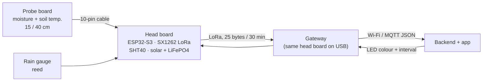

# Gaiapus · Hardware

**NASA Space Apps Challenge 2026** · *Field Shift: Adapting Farms with NASA Data* · Team Gaiapus

This folder contains the **Gaiapus soil stake**: electronics, firmware, bill of materials, mechanical CAD and renders. For the project overview, the decision engine and the app, see the [main README](../README.md).

The stake is a low-cost solar device that measures a field where satellite data is too coarse. It measures soil moisture and soil temperature at 15 and 40 cm, air temperature and humidity, and rainfall. It sends the readings over LoRa to a community gateway, and the backend uses them to correct NASA data (SMAP, GPM IMERG, POWER) for that field.

| 3D model of the stake (generated from the boards and the case) | Exploded view (rev G) |
|---|---|
|  |  |

---

## Status

| Part | Status | Evidence |
|---|---|---|
| Schematics of both boards (head + probe) | complete, ERC with no errors | `hardware/gaiapus-node`, `hardware/gaiapus-probe` |
| Head PCB (90 × 50 mm, 4 layers) | routed 51/51 nets, DRC with no errors | `hardware/gaiapus-node/*.kicad_pcb`, 3D model `.glb`/`.step` |
| Probe PCB (22 × 450 mm, 2 layers) | routed 12/12 nets, DRC with no errors | `hardware/gaiapus-probe/*.kicad_pcb` |
| Bill of materials with cost | every main part with LCSC code and price | `bom/` |
| Power budget | computed from datasheet values | `power/power_budget.py` |
| Case, stake and rain gauge (rev G) | drawings, printable 3MF files, full 3D assembly, 36/36 checks passed, 0 mm³ interference | `mechanical/` |
| Stake and gateway firmware | complete, tested on a PC (9 simulated hours, network outage, resend) | `firmware/` |
| Bench prototype | ESP32 dev board + off-the-shelf sensors, same firmware and protocol | `firmware/src/main.cpp` |
| Physical PCB prototype | **not manufactured yet** | — |

## Key numbers

| | Value |
|---|---|
| Measurements | soil moisture and temperature at 15 and 40 cm, air temperature and humidity, rainfall, battery |
| MCU and radio | ESP32-S3-MINI-1 + EBYTE E22-900MM22S (SX1262), regional band 868/915 MHz configurable |
| Packet | 25 bytes every 30 min; 6-byte ACK carries the LED colour and interval |
| Consumption | 1.2–1.8 mAh/day (50–75 µA average) |
| Energy | 0.3 W panel (68 × 37 mm) + LiFePO4 18650 cell; positive balance even on a cloudy day |
| Autonomy without sun | about 1 year by calculation (target was 14 days) |
| Rain gauge | tipping bucket, 100 mm collector, 0.201 mm per pulse |
| Component cost | ≈ US$ 30 per stake (1 unit), less in volume; PCB, assembly and case still to be quoted |
| Comparison | a commercial single-depth soil sensor costs US$ 258–615, without the logger |

Details, sources and limits of each number: [`docs/hardware.md`](docs/hardware.md).

---

## Where to start

### Reviewers
1. [`docs/hardware.md`](docs/hardware.md): why each component, power, cost, market comparison, risks.
2. [`docs/firmware.md`](docs/firmware.md): how the stake measures, stores and sends data to the backend.
3. [`docs/protocolo-dados.md`](docs/protocolo-dados.md) (Portuguese): the 25-byte packet and the JSON the app receives.
4. 3D model of the whole stake: [`mechanical/cad/revG/gaiapus-stake-revG-assembly.glb`](mechanical/cad/revG/gaiapus-stake-revG-assembly.glb) (opens in Windows 3D Viewer, Blender or https://gltf-viewer.donmccurdy.com).
5. Case and rain-gauge drawings: [`mechanical/drawings/gaiapus-case-revG.pdf`](mechanical/drawings/gaiapus-case-revG.pdf).
6. Bill of materials with prices: [`bom/bom_custos_BRL.xlsx`](bom/bom_custos_BRL.xlsx).

### Team
| I want to... | Do |
|---|---|
| Open the boards | KiCad 8: `hardware/gaiapus-node/gaiapus-node.kicad_pro` and `hardware/gaiapus-probe/gaiapus-probe.kicad_pro` |
| Change the circuit | edit `hardware/tools/gen_kicad.py` and run `check_kicad.py` (see [`hardware/README.md`](hardware/README.md)); close KiCad first |
| Flash the stake | `cd firmware && pio run -e stake-lora -t upload` (other targets in [`firmware/README.md`](firmware/README.md)) |
| Run the firmware tests | in `firmware/test`, commands in [`firmware/README.md`](firmware/README.md) (needs only `gcc` and `python3`) |
| Recompute the energy budget | `python power/power_budget.py --help` |
| Print the case and rain gauge | 3MF files in `mechanical/cad/revG/`, already in print orientation ([`mechanical/README.md`](mechanical/README.md)) |
| Integrate the backend | subscribe to `gaiapus/devices/+/up` and publish the command to `gaiapus/devices/{id}/down` ([`docs/firmware.md`](docs/firmware.md) § 8) |

---

## Structure

| Folder | Contents |
|---|---|
| `docs/` | hardware and firmware reference, data protocol, requirements, decision log |
| `hardware/gaiapus-node/` | head board (KiCad 8): ESP32-S3, LoRa radio, solar power, air sensor, LEDs, USB-C |
| `hardware/gaiapus-probe/` | probe board (KiCad 8): moisture electrodes and temperature sensors inside the tube |
| `hardware/lib/` | symbols, footprints and 3D models |
| `hardware/datasheets/` | datasheet of every main component |
| `hardware/tools/` | board generation, placement, routing and verification scripts |
| `bom/` | bill of materials and costs |
| `power/` | power budget |
| `firmware/` | stake, gateway and bench firmware, with tests |
| `mechanical/` | case, stake, rain gauge, drawings, printable parts, 3D assembly and renders |
| `renders/` | product concept image (AI-generated) |

## Renders

- **From our CAD** (`mechanical/cad/revG/renders/`): head views, rain gauge, sections, full stake, exploded view with 21 numbered parts, and a side-by-side comparison with the concept image.
- **Concept** (`renders/design-base-v1.jpg`): **AI-generated** image used only as a style reference for the product's look. It is not a photo or a render of the real design.

---

## Declared limits

- The PCB **has not been manufactured yet**. Power, radio range and sensor readings come from datasheets, calculation and simulation, not from measurement.
- Measuring moisture **through the tube wall** is an assumption to be tested in real soil. If the wall attenuates too much, plan B is to open windows in the tube without changing the board.
- The stake measures to **decide** (irrigate, plant, wait), not for research: it needs per-probe calibration (air and water) and per-soil-type calibration.
- The price quoted is for **components**, not a retail price.
- Data marked **(Brazil)** in the docs comes from the pilot in Uberlândia (MG). The hardware works in any region by changing the radio band in firmware.

## Sources, tools and libraries

- **NASA POWER** (`ALLSKY_SFC_SW_DWN`, solar irradiance) is used to size the solar panel for any location.
- **Tools:** KiCad 8, PlatformIO/Arduino, Python (CadQuery/trimesh-based CAD and drawing scripts in `mechanical/tools/`).
- **Libraries:** RadioLib, PubSubClient, DHTesp.
- **Parts:** LCSC/JLCPCB part library and 3D models; component datasheets in `hardware/datasheets/`.
- Market and agricultural statistics with links: [`docs/hardware.md`](docs/hardware.md) → *Sources*.

## AI assistance

In line with the NASA Space Apps rules on Super Intelligence (SI) tools:

- **Images:** `renders/design-base-v1.jpg` is an **AI-generated** concept image. All other renders and drawings are generated from our own CAD and KiCad models.
- **Code:** parts of the firmware and of the Python tooling (board generation, routing and verification, mechanical CAD and drawings, power budget) were written with the help of an AI assistant (Claude, by Anthropic) and reviewed, tested and integrated by the team.
- **Text:** documentation drafts and translations were produced with AI assistance and reviewed by the team.

No NASA logos or branding are used.

## Design rules

1. Everything SMD soldered directly to the board, with certified modules for radio and MCU. No pin headers, sockets or development boards.
2. Every component with footprint, 3D model, datasheet and LCSC code (cost and assembly at JLCPCB).
3. Every relevant choice goes into [`docs/decisoes.md`](docs/decisoes.md) with its reason.
4. Data from a specific country is always marked as such.
